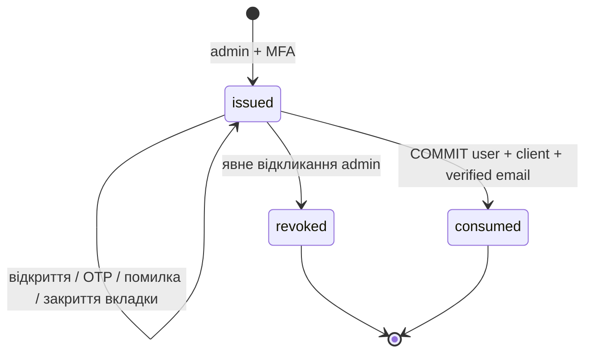

> **AUTH-3, 22.10.2026:** реалізовано спільний durable MFA, recovery та server assurance
> gate для контрольованого Filament. За замовчуванням вимкнено; production rollout
> заблоковано P3/P5/P6. Точна поведінка, контракт і перевірки — [auth3.md](auth3.md).
> Нижче збережено історичний стан попереднього етапу.

> **AUTH-2, 22.10.2026:** користувач затвердив P1/P2/P4: additive PostgreSQL-схему,
> штатні Laravel session guards без Sanctum/Fortify з окремими client/admin контекстами,
> Filament email+password+mandatory TOTP та PWA passwordless email OTP+optional TOTP,
> один durable MFA-сервіс. Реалізовано лише сховище, read-only preflight, codec і PG-тести;
> production auth/gates ще немає. P3/P5/P6 відкриті; normalized email/backfill заблоковано
> до окремого рішення. Точний стан і межі: [auth-schema.md](auth-schema.md).
> Подальші формулювання про непогоджені P1/P2/P4 — історичний дизайн AUTH-0/1.

# Закрита реєстрація, клієнтський вхід і MFA

**Статус:** технічний дизайн, без реалізації. **Дата:** 21.10.2026.
База перевірки — актуальний GitHub `master` `76b00a5dd996d4f3a346ee935944f267de1beae3`
(merge PR #6). Локальний початковий checkout `25c402c` застарілий; через недоступний
Git-проксі поточні файли прочитано через GitHub API за SHA. Цей документ і супровідні
Markdown-зміни не змінюють код, міграції, SQL/DBML, залежності чи БД.

## 1. Межа між рішенням і пропозицією

### Затверджено користувачем

| ID | Рішення |
|---|---|
| A1 | Новий клієнт реєструється тільки за одноразовим персональним запрошенням, створеним адміністратором у Filament. Посилання не прив'язане до email; адміністратор може його відкликати. Відкриття чи перевірка email не витрачає запрошення: використання — тільки після успішної реєстрації. |
| A2 | PWA: email + одноразовий OTP, без пароля. Повторний вхід — так само, без нового запрошення. |
| A3 | Один `users.id`, максимум один `clients`, спільні дані PWA/Telegram Mini App. |
| A4 | Telegram приєднується до наявного акаунта після підтвердження володіння ним; автоматичне об'єднання за email, ім'ям або username заборонене. |
| A5 | Опційна TOTP-2FA через Authenticator та одноразові резервні коди входять у найближчий етап; для адміністратора MFA обов'язкова. |
| A6 | Адміністративне відновлення 2FA — захищена дія Filament після незалежної перевірки особи, з відкликанням сесій та аудитом, без прямого SQL-редагування. |
| A7 | Passkeys передбачити в архітектурі; зараз не реалізовувати. |
| A8 | Реєстрація не активує платний супровід. |

Усе нижче — **технічні пропозиції**, а не нові затверджені бізнес-правила.
Зокрема таблиці, поля, TTL, cookies, маршрутні контракти, спосіб первинного входу
admin та процедура перевірки особи потребують погодження перед реалізацією (§13).
Прямий запит на цей дизайн дозволяє описати нові сутності й створити Draft PR;
він не дозволяє переносити їх у SQL/DBML чи БД. G3/R1 не переглядається.

Персональне посилання без прив'язки до email — bearer capability: сервер не може
визначити особу того, кому переслали URL. OTP доводить контроль вибраної скриньки,
а не особу первинного адресата запрошення. Адміністратор передає URL адресно через
перевірений канал; витік означає відкликання. Автоматично забезпечити «одна фізична
людина — один акаунт» для різних непов'язаних email неможливо; система гарантує
унікальність підтверджених ідентифікаторів і профілю, без евристичного об'єднання.

## 2. Фактичний стан і перевірка сумісності

- `composer.json`: Laravel `^13.17`, PHP `^8.3`, Filament `~5.0`;
  `composer.lock`: `laravel/framework v13.38.0`, Filament `v5.10.2`.
  Fortify і Sanctum відсутні в lock; нічого не встановлювалось.
- Є стандартні `users`, `sessions`, `password_reset_tokens`, cache/jobs та
  additive-міграція узгодження `users`: BIGINT PK, nullable email/password,
  nullable UNIQUE `telegram_user_id`, роль з default `client`.
- Stage 1 уже має міграції модулів 01–04 і `btree_gist`; фактичні FK до `users`
  адаптовані до BIGINT. `clients.id` залишається integer; `clients.user_id`
  nullable UNIQUE, тренер обов'язковий. Не копіювати integer FK до `users` із
  еталонного SQL, оминаючи затверджений R1.
- `User` має зв'язки з `Client`, hashed password cast, але не має MFA.
  `AdminPanelProvider` використовує стандартний login і guard `web`;
  `canAccessPanel()` перевіряє лише роль admin. Це ще не захист MFA.
- Stage 2: редагування/перегляд карток admin, створення заборонене Policy та
  Livewire; перехідні NULL-картки редагуються. Поле `user_id` поки можна змінювати
  в адмінці — перед запуском реєстрації його слід замінити захищеною дією прив'язки.
- У `/api` зараз лише public health, група stateless; SPA — каркас без auth.
  У `bootstrap/app.php` немає `statefulApi()`, Vite проксює лише `/api`.
- Наявні тести: основний PHPUnit/SQLite; PostgreSQL-набір `BusinessSchemaTest`
  і `ClientResourceTest` перевіряє схему, роль панелі, заборону створення, UNIQUE,
  статуси. Вони не перевіряють запрошення, OTP чи MFA. Історичні результати
  Stage 1/2 не є результатами security-тестів цього дизайну.

### Перевірені upstream-джерела

Перевірено вихідний код, а не припущення за назвою пакета:

| Компонент / зафіксована ревізія | Висновок |
|---|---|
| [Laravel v13.38.0, Middleware](https://github.com/laravel/framework/blob/v13.38.0/src/Illuminate/Foundation/Configuration/Middleware.php) | `statefulApi()` підключає Sanctum middleware. Сесійний browser API — явне розширення поточної stateless-групи, а не вже наявна можливість застосунку. |
| [Sanctum 4.x, composer](https://github.com/laravel/sanctum/blob/c33d50f6f1dd9fa0b1672c24611ca83a939b0583/composer.json) і [stateful middleware](https://github.com/laravel/sanctum/blob/c33d50f6f1dd9fa0b1672c24611ca83a939b0583/src/Http/Middleware/EnsureFrontendRequestsAreStateful.php) | Constraints допускають Illuminate 13. Cookie/session SPA не потребує клієнтського пароля чи bearer token; Sanctum не реалізує OTP, запрошення або MFA. |
| [Fortify 1.x, composer](https://github.com/laravel/fortify/blob/7aa4ac434062c2f4754985ab74adb1dcb11f1123/composer.json), [LoginRequest](https://github.com/laravel/fortify/blob/7aa4ac434062c2f4754985ab74adb1dcb11f1123/src/Http/Requests/LoginRequest.php), [routes](https://github.com/laravel/fortify/blob/7aa4ac434062c2f4754985ab74adb1dcb11f1123/routes/routes.php) | Constraints допускають Illuminate 13, але LoginRequest вимагає `password`; увімкнений `confirmPassword` додає `password.confirm` до керування 2FA. Поточна перевірена гілка також залежить від `laravel/passkeys`; це не причина вмикати Passkeys зараз. |
| [Fortify RedirectIfTwoFactorAuthenticatable](https://github.com/laravel/fortify/blob/7aa4ac434062c2f4754985ab74adb1dcb11f1123/src/Actions/RedirectIfTwoFactorAuthenticatable.php), [AttemptToAuthenticate](https://github.com/laravel/fortify/blob/7aa4ac434062c2f4754985ab74adb1dcb11f1123/src/Actions/AttemptToAuthenticate.php) | Callback автентифікації викликається в обох діях. Не витрачати одноразовий OTP у callback двічі. Стандартний pipeline не є готовим passwordless-рішенням. |
| [Filament v5.10.2 HasAuth](https://github.com/filamentphp/filament/blob/v5.10.2/packages/panels/src/Panel/Concerns/HasAuth.php), [AppAuthentication](https://github.com/filamentphp/filament/blob/v5.10.2/packages/panels/src/Auth/MultiFactor/App/AppAuthentication.php) | Є `multiFactorAuthentication(..., isRequired: true)`, app TOTP, хешовані recovery codes, блокування повторного коду. Потрібні адаптери до єдиного сховища/сервісу та перевірка повного потоку, а не лише перемикач panel. |

**Пропозиція:** власні дії `IssueEmailOtp`, `VerifyEmailOtp`,
`CompleteInvitationRegistration`, `CompleteAuthentication`, `VerifySecondFactor`,
`RecoverMfa`; контролери в `App\Http\Controllers\Api` тільки викликають їх.
Sanctum — кандидат для stateful SPA після погодження залежності й integration spike.
Альтернатива без пакета — явні session/CSRF middleware на browser `/api`-підгрупі;
перед реалізацією обрати один варіант. Fortify не підключати типовими auth-роутами;
його компоненти можливі лише після перевірки адаптера без `password.confirm`,
відкритої реєстрації й повторного споживання OTP. Для TOTP спочатку оцінити вже
наявний Filament AppAuthentication, не писати власну криптографію.

Це перевірка constraints і коду на конкретних SHA, **не** Composer-resolution
або runtime-сумісність: install/update, нові залежності й spike тут не виконувались.
Перед реалізацією зафіксувати release/tag і провести resolver + інтеграційні тести.

## 3. Модель даних — пропозиція для майбутніх міграцій

Усі часові поля нижче — UTC `timestamptz`, крім незмінених Laravel-полів.
Нові внутрішні PK — BIGINT; публічні challenge/flow ID — криптографічно випадкові
128+ біт, вони не є самостійним доказом авторизації. FK до `users` — BIGINT,
до `clients` — integer. Імена пропонуються, не оголошуються частиною чинної схеми.

| Сутність | Поля та обмеження |
|---|---|
| `users` (розширення) | `email_normalized` nullable varchar(255) UNIQUE; `auth_version` bigint NOT NULL default 0 CHECK ≥0; `mfa_required` boolean default false; `mfa_recovery_required_at` nullable. Обов'язковість MFA для `role=admin` перевіряється незалежно від boolean. Не змінювати PK, role/default, password чи наявні ID. |
| `client_invitations` | `id`; `token_hash` char(64) UNIQUE NOT NULL; `created_by_user_id`, `coach_user_id` NOT NULL FK RESTRICT; `target_client_id` nullable FK RESTRICT для явної міграції перехідної картки; `expires_at` nullable (NULL без автостроку; заданий строк перевіряється при consume); `created_at`, `revoked_at`, `revoked_by_user_id`; `consumed_at`, `consumed_by_user_id` FK RESTRICT; **немає email**. CHECK парності consumed timestamp/user і неможливості одночасно consumed/revoked. Індекс coach та активних запрошень; UNIQUE(`target_client_id`) WHERE consumed_at IS NULL AND revoked_at IS NULL для цільових карток. |
| `auth_challenges` | `id`, `public_id` UNIQUE; `purpose` text CHECK (register/login/reauth/email_change/link_email); `user_id` nullable FK; `invitation_id` nullable FK; `email_normalized`; `code_mac` char(64), `key_version`; `browser_binding_hash`; `flow_id`; `generation` int; `attempts` int default 0 CHECK 0..5; `created_at`, `expires_at`, `consumed_at`, `invalidated_at`; індекси expiry, user, email+purpose. UNIQUE(flow_id,generation); latest-generation контроль під lock. CHECK register вимагає invitation_id, login/reauth — user_id для реального challenge. Dummy challenge невідомого email зберігати окремим непривілейованим flow без OTP. |
| `auth_flows` | Серверний стан первинної перевірки/step-up: `public_id` UNIQUE; binding hash; `user_id`/`invitation_id`; `purpose`; `state` CHECK; `primary_verified_at`; `auth_version_at_start`; `expires_at`; `consumed_at`; generation; nullable `capability_hash` UNIQUE для recovery/link grant; nullable `action` та session binding для reauth. Унікальний active slot для browser+purpose; зміна generation під row lock. Не зберігати auth state лише в React. |
| `user_totp_factors` | `user_id` PK FK; `secret_ciphertext`, `key_version`; `pending_secret_ciphertext`, `pending_expires_at`; `confirmed_at`; `last_used_step` bigint; `created_at`, `updated_at`. Підтверджений секрет замінювати тільки атомарно після доказу старого і нового факторів. Ключі шифрування поза БД. |
| `mfa_recovery_codes` | `id`, `user_id` FK; випадковий `selector` UNIQUE; `code_hash` (Argon2id через Laravel Hash); `batch_id`; `created_at`, `used_at`. Індекс user+batch; перевірка й витрачання під lock. Рівно один активний batch задає сервіс у транзакції. |
| `auth_session_states` | `session_id` PK, зв'язок з наявною `sessions.id`; `user_id` FK; `audience` client/admin; `auth_version`; `primary_method`; `primary_verified_at`; `mfa_verified_at`; `mfa_method`; `reauthenticated_at`; `absolute_expires_at`; `revoked_at`. Browser binding і context для step-up. FK CASCADE при видаленні session; індекс user+audience. Не дублювати session payload. |
| `auth_audit_events` | `id`, `occurred_at`, nullable actor/subject user IDs, `event_type`, `outcome`, `request_id`, `session_fingerprint`, псевдонімізовані IP/UA, `reason_code`, `case_reference`, дозволений metadata JSON. Для видалення user — SET NULL із збереженням події; ніяких секретів чи копій документів. Append-only для application role; окрема retention-процедура. |

`auth_flows` охоплює restricted MFA та recovery enrollment, тому окрема довгоживуча
таблиця «тимчасових JWT» не потрібна. Стан облікового запису, факторів і сесій читає
єдиний auth-сервіс для API та Filament; MFA не дублюється у двох незалежних полях.
Шифровані секрети ховаються від Eloquent serialization; QR/OTP не логуються.

### Нормалізація email й захист від дублювання

Пропонується trim, ASCII lowercase усього email, IDNA domain, максимум 254 байти;
SMTPUTF8 локальна частина у першому етапі не підтримується. Це потребує погодження:
RFC допускає case-sensitive local-part. Не видаляти `+tag`, крапки й не застосовувати
Gmail-специфічні перетворення. `email` зберігає адресу доставки, `email_normalized`
є ключем пошуку. Сервіс завжди записує обидва; майбутній DB CHECK/trigger забезпечує
їх відповідність узгодженій функції нормалізації, включно з nullable-парністю.

Після переходу не дозволяти існування непідтвердженої адреси як входу чи резервування
імені: реєстрація створює user тільки після OTP. Старі `email_verified_at=NULL`
не вважати перевіреними і **не** дозволяти OTP автоматично підтвердити/переприв'язати
такий запис — потрібна окрема перевірка походження, особливо для admin/Telegram.
Публічний OTP-вхід дозволений лише чинним підтвердженим client-акаунтам із профілем;
існуючі акаунти без профілю й непідтверджені адреси — окремий контрольований перехід.

### Безпечна послідовність міграцій (не виконувати в цьому PR)

1. Read-only preflight у погодженому середовищі: фактичні типи/FK, колізії
   нормалізованих email, непідтверджені адреси, наявні admin і NULL-картки.
   Звіт без PII. Колізія зупиняє міграцію; не об'єднувати й не видаляти записи.
2. Additive-міграції нових таблиць/nullable колонок окремими файлами після Stage 1;
   не редагувати історичні міграції або SQL snapshot. Зміни Entity Catalog/SQL/DBML
   для auth схеми — окремий погоджений PR до або разом із реалізацією схеми.
3. Пакетний backfill normalized email лише після вирішення колізій; не змінювати
   `email_verified_at`, ролі, password, Telegram ID, платний статус. Тимчасово
   заборонити запис email під час фінальної валідації або мати перевірений dual-write.
4. Для великої таблиці UNIQUE index будувати CONCURRENTLY в окремій нетранзакційній
   міграції з перевіркою invalid index після збою; `lock_timeout=5s`,
   `statement_timeout=5min` як пропозиція. FK/CHECK — NOT VALID + VALIDATE там, де
   PostgreSQL дозволяє; UNIQUE не додавати як NOT VALID. На малих нових таблицях
   звичайні транзакційні constraints. Невдача — зупинка, без ослаблення UNIQUE.
5. Спочатку розгорнути код із закритими auth routes, протестувати downgrade/upgrade
   на синтетичній PostgreSQL 18, потім увімкнути потоки. До публічного запуску
   увімкнути обов'язкову admin MFA; старі сесії admin відкликати.
6. Rollback: вимкнути нові входи, зберегти фактори/аудит. `down()` відмовляється
   знищувати непорожні security-таблиці; використовувати forward fix. Не повертати
   password NOT NULL, не перестворювати `users`, не скидати запрошення у valid.

## 4. Запрошення та атомарна реєстрація

Уточнення AUTH-2, погоджене рев’ю 22.10.2026: **без автоматичного TTL запрошення**
до затвердження P3. `client_invitations.expires_at` nullable: NULL залишає
запрошення чинним до успішного використання або явного відкликання. Якщо строк
заданий явно, consume перевіряє `expires_at > clock_timestamp()`; CHECK вимагає
expiry після created_at та consume строго до expiry. Це можливість сховища,
не затвердження автоматичної TTL-політики для майбутнього issuance. Огляд невикористаних через 7/30 днів — нагадування
admin, без автоматичного відкликання. Інші короткі challenge мають TTL (§10).

Filament дія створення перевіряє роль admin, завершену MFA та свіжий step-up;
coach/admin відповідальний обирається явно, без default. Генерує 32 random bytes,
base64url (256 біт), зберігає лише SHA-256 token. Повний URL показується один раз;
повторне отримання неможливе: втрачений URL відкликати й створити новий. Список
показує ID, тренера, дату, стан; ніколи токен. Відкликання — Policy + server action,
CSRF, MFA, аудит, row lock. Consumed не можна відкликати або повторно активувати.

URL пропонується `/app/register#invite=<token>`: fragment не потрапляє в HTTP
access log/Referer. React негайно прибирає fragment через replaceState, передає token
тільки в POST body; не зберігає у localStorage/analytics. Після обміну сервер тримає
binding до invitation у restricted flow. Відкриття GET ніколи не змінює стан і не
витрачає токен; email-сканер/preview не може зареєструвати клієнта. `no-referrer`,
`Cache-Control: no-store`, без сторонніх скриптів на auth-екранах; redaction body.

### Протокол нового клієнта

1. POST обміну токена створює browser-bound registration flow. Повторно перевіряти
   invitation на кожному суттєвому кроці. Пропозиція: admin спочатку визначає coach;
   ім'я вводить клієнт. Не приймати role, coach_user_id, client_id чи coaching status
   від браузера. Target NULL-картку задає лише admin після незалежної перевірки.
2. Введення email створює challenge `purpose=register`, прив'язаний до flow,
   invitation і браузера. Видача коду не створює user/client і не резервує email.
3. OTP перевіряється під lock; отриманий доказ записується в flow, OTP витрачається.
   Це ще не використання invitation. Фіналізація приймає ім'я й чинний flow,
   не довільний email або `email_verified=true` із запиту.
4. `DB::transaction`: блокувати flow → invitation → за наявності user → target
   client; у всіх діях дотримуватися цього порядку, підтримати обмежений retry
   deadlock. Заново перевірити state, generation, TTL доказу, browser binding,
   revoked/consumed, поточну роль coach/admin, заборону самосупроводу.
5. Якщо normalized email уже належить user — **не** робити upsert або автоматичний
   attach. Повернути нейтральний conflict без ідентичності, invitation залишити
   чинним; користувач проходить звичайний вхід і MFA. Додавання профілю до чинного
   акаунта без clients — окремий сценарій із fresh auth, тим самим invitation і
   явним підтвердженням; не в початковому endpoint. Для наявного clients — звичайний
   вхід, без нової картки і без споживання нового invitation.
6. Створити user (`role=client`, password NULL, verified email з доказу), потім
   client (`status=pending`, coaching_started_at NULL, coach із invitation).
   Для target NULL-картки: під lock пересвідчитися в `user_id IS NULL`, явній
   перевірці особи, зберегти її статус і історію; не скидати active/paused. Нова
   реєстрація сама не змінює платний статус існуючої картки. Не створювати анкету
   з вигаданим JSON-контрактом. Звичайне запрошення не шукає картку за ім'ям/email.
7. У тій самій транзакції conditional update invitation, де consumed/revoked NULL,
   встановлює consumed_at/by; рівно 1 affected row. Позначити flow завершеним,
   записати аудит. UNIQUE email_normalized і clients.user_id — остаточний бар'єр.
   При будь-якій помилці rollback усіх записів, invitation залишається чинним.
8. Після COMMIT ротація session ID/CSRF, створення повного session state; mail/events
   через afterCommit, без мережевих викликів усередині транзакції. Сесійний збій після
   COMMIT не «повертає» invitation: відновити вхід через email OTP. Повтор final POST
   не створює нічого й не видає повторно сесію. Стани перевіряються сервером.

Два запити з одним invitation серіалізуються на його row lock: один commit, другий
отримує unavailable. Два invitation з одним email впираються в UNIQUE: програшна
транзакція rollback, її invitation не використано. Відкликання під тим самим lock
виграє тільки до commit реєстрації; результат після commit — consumed. Претензія
на NULL-картку також блокується й перевіряється в транзакції. Валідація Eloquent
до запису не замінює ці обмеження.

## 5. Email OTP та повноцінний вхід

Пропозиція: 8 випадкових десяткових цифр через CSPRNG, 5 хвилин, 5 спроб;
HMAC-SHA-256 від challenge ID + purpose + normalized email + generation + code з
окремим versioned ключем поза БД. Простий SHA короткого OTP не захищає від offline
перебору при витоку БД. Constant-time порівняння; код ніколи не повертається API.

`request` завжди повертає 202 й однаковий JSON/клас затримки для чинного,
невідомого, непідтвердженого та адміністративного email. Невідомому email не
створюється user і не надсилається login-code; dummy flow має той самий зовнішній
формат. Відправлення асинхронне; помилки доставки не розкривають існування акаунта.
Не надсилати на довільний email без invitation або чинного client login.

Один актуальний challenge на browser flow/purpose; resend збільшує generation,
інвалідує попередній код і не скидає спільний budget спроб. Інший браузер не
інвалідує challenge жертви. Код з одного purpose/flow не годиться для іншого.
Queue payload з OTP шифрувати, обмежити TTL і redaction failed_jobs; retries не
генерують нового коду, worker перевіряє generation/expiry, не надсилає прострочене.
Перевірку/лічильник/consumed_at змінювати атомарно під row lock, включно з невдалою
спробою: помилка HTTP після transaction не повинна відкотити attempts. Новий
challenge не обходить ліміту на email/account. TTL перевіряється серверним UTC.

Після OTP login: `primary_verified → mfa_pending` для підтвердженої TOTP або
обов'язкової MFA; без фактора в optional client — `authenticated`. До останнього
стану **не** викликати guard login й не видавати PAT. Restricted flow містить user ID
лише серверно, має binding/TTL/auth_version. `/api/me` й бізнес-API дають 401 для
mfa_pending; тільки endpoints challenge/logout дозволені. Код/flow одноразовий.
При втраті відповіді після витрачання OTP можна запросити новий; replay не логінить.

Email-only вхід не захищає від захоплення скриньки. Для client з TOTP атакувальник
з доступом до email не отримує повну сесію, не може вимкнути MFA чи прив'язати канал.
Email не є запасним другим фактором і не скидає TOTP. Не відновлювати акаунт за
ім'ям/username або листом із уже скомпрометованої скриньки.

## 6. Сесії, CSRF, авторизація та повторна автентифікація

**Пропозиція:** first-party browser session cookies, без JWT/PAT у localStorage.
Окрема stateful `/api/auth` та protected `/api`-підгрупа з session/CSRF; health
залишається public/stateless. Це потребує явно погодженої поправки до поточного
опису stateless API. Публічний browser auth приймає лише session guard;
не дозволяти bearer PAT як альтернативний обхід MFA у цій підгрупі. Sanctum `auth:sanctum` сам собою не перевіряє завершення MFA.
Порядок захисту: session → auth/version/expiry → completed MFA → role/Policy/ownership.

Для збереження правила «SPA тільки `/api`» пропонується `GET /api/auth/csrf` з
session/CSRF middleware як аналог Sanctum CSRF bootstrap; `/sanctum/csrf-cookie`
не викликається SPA напряму. Після bootstrap усі unsafe запити, включно з login,
перевіряють CSRF і Origin; Accept JSON. Same-origin production; allowlist dev origin
без wildcard credentialed CORS. Vite уже проксює `/api`; cookie Secure у production,
окремий задокументований HTTP localhost режим лише для dev.

Client і admin — окремі session guards/cookies та audience. Admin cookie обмежити
`/admin` і host-only, client cookie host-only path `/`; різні імена (admin не може
використати `__Host-` з path `/admin`). `Secure`, `HttpOnly`, `SameSite=Lax`, без
широкого `.domain`. XSRF cookie доступна JS, session cookie — ні. Browser client
session користувача з admin role **не** відкриває Filament. Default `web` панелі
перевести на admin guard тільки окремим перевіреним етапом.

Зберігати сесії серверно (`sessions` уже є), шифрувати payload at rest або
застосовувати encrypted session store. Повна сесія має timestamps, audience та
знімок auth_version в `auth_session_states`; на кожному запиті перевіряються
absolute/idle expiry, актуальна версія user, confirmed factor і вимога admin MFA.
Після OTP+MFA ротація ID з видаленням старої сесії та генерацією нового CSRF;
після step-up оновлювати стан і ID без продовження absolute expiry.

Reauth — окремий одноразовий flow, прив'язаний до поточної session, user, purpose
і auth_version. Потрібен новий email OTP; якщо TOTP активна/обов'язкова — також
TOTP (або один резервний код), а не лише ознака старого входу. Для admin з паролем —
повтор пароля + TOTP. Доказ видається для конкретної чутливої дії, витрачається
атомарно і діє 5 хвилин; не приймати `reauthenticated_at` від клієнта.

Sensitive actions: email change/link/unlink, MFA enable/disable/replace, регенерація
резервних кодів, revoke all sessions; для admin також запрошення, recovery іншого
користувача, зміна прив'язки перехідної картки. Перший enrollment без TOTP вимагає
свіжого primary proof, завершення — коду нового Authenticator. Видалення останнього
доступного способу входу заборонене; admin не може зняти обов'язковість MFA.

Logout видаляє поточну session і state, інвалідує cookie/CSRF. Logout-all, recovery,
зміна email/фактора/ідентичності збільшують auth_version, відкликають усі browser/admin
сесії й незавершені flows/challenges; у майбутньому також PAT. Version check
захищає від воскресіння сесії паралельним запитом після delete. Чутливі мутації
перевіряють version повторно під user lock у своїй транзакції, тому запит, який
пройшов middleware до recovery, не зможе змінити фактори після відкликання. Недоступність
central rate-limit/session/MFA store закриває auth, без fallback у permissive mode.
Client Policy завжди обмежує `clients.user_id=authenticated user`, незалежно від
платного статусу. `pending` дозволяє вхід, але не автоматичний доступ до платних дій.

PWA service worker не кешує `/api/auth`, `/api/me`, QR, відповіді приватного API;
`Cache-Control: no-store`. Offline shell не означає чинну auth-сесію. CSP без
довільних сторонніх скриптів, escaped rendering, очищення пам'яті auth-форм;
HttpOnly не нейтралізує XSS, тому CSRF/CSP і browser security tests обов'язкові.

## 7. TOTP, резервні коди й admin MFA — найближчий етап

TOTP: RFC 6238, SHA-1 для сумісності Authenticator, 6 цифр, 30 s, секрет щонайменше
160 random bits; window ±1 step (90 s з урахуванням сусідніх інтервалів), NTP на
сервері. Зберігати accepted timestep і вимагати `step > last_used_step` під row lock
для всіх каналів, включно з enrollment/reauth; повтор коду не приймається навіть
у різних сесіях. Показати очікування наступного коду, якщо поточний уже використано.

Enrollment: fresh primary proof → pending encrypted secret (10 хв) → QR/manual key
один раз → підтвердження TOTP → атомарно confirmed factor + новий batch резервних
кодів + auth_version bump + аудит. Незавершений enrollment не вмикає client MFA;
для admin він не дає доступу до панелі. Не перезаписувати активний секрет на старті
заміни; старий діє до успішного підтвердження нового. Secret/QR не повертати з GET
профілю і не включати в логи, експорт або backup без шифрування.

Пропозиція: 10 recovery codes по 128 random bits кожен (base32, групи для введення),
selector + Argon2id hash. Повний набір показується лише один раз після генерації;
користувач зберігає offline. Окремий `used_at` змінюється під lock, тому дві
паралельні перевірки дають один успіх. Код замінює другий фактор **після** primary,
не email OTP/пароль. Login із recovery code не вимикає TOTP; показати попередження
і число залишків. Regenerate потребує fresh primary+MFA, знищує попередній batch
атомарно, відкликає старі сесії, створює audit + безсекретне повідомлення.

Admin: пропозиція зберегти окремий Filament email+password primary (чинний код) +
обов'язковий app TOTP/recovery code. Це **не** парольна залежність PWA. Password
reset, якщо згодом увімкнений, не скидає MFA. Email OTP клієнта не може стати
адмінським входом. Filament AppAuthentication адаптується до єдиного факторного
сервісу, а не створює паралельне сховище. Required enrollment middleware не замінює
перевірку пройденого MFA на кожній сесії, HTTP, Livewire і sensitive action.

Перший admin enrollment — контрольований rollout: після primary доступ тільки до
setup/logout, нуль бізнес-даних. До примусового rollout зареєструвати TOTP й зберегти
offline recovery codes; відкрити нову тестову сесію, перевірити фактор, потім
відкликати всі старі сесії. Без «grace period» із доступом без MFA.

## 8. Відновлення й захист зміни email

### Самостійне відновлення

Є primary + recovery code → login з MFA, відновлення Authenticator під fresh step-up.
Є TOTP, втрачена скринька → це **не** автоматичний login: незалежна перевірка особи
та контрольована зміна email. Втрачено обидва фактори/коди → адміністративний recovery.
Email OTP не вимикає TOTP. Будь-яка заміна email потребує підтвердження нової адреси
і старого способу входу; саме знання нової адреси не дає права отримати акаунт.

### Захищена дія Filament

1. Policy дозволяє лише admin із MFA, fresh step-up ≤5 хв, не самому собі.
   Ввести reason_code і case_reference, підтвердити незалежну перевірку особи.
   Пропозиція: заздалегідь погоджений відеозв'язок/особиста перевірка через відомий
   канал. Лист із тієї самої скриньки, ім'я, username чи неперевірений Telegram
   не є незалежним доказом. Не зберігати копії документів у auth metadata.
2. Показати user ID, обсяг відкликання, стан факторів; підтвердити дію повторно.
   Для recovery іншого admin запропоновано двох різних уповноважених admin.
   Це організаційна пропозиція; без такого процесу recovery admin не відкривати.
3. Транзакція під user/factor locks: збільшити auth_version, інвалідувати всі
   sessions/flows/challenges та recovery codes, прибрати можливість старого TOTP,
   поставити `mfa_recovery_required_at`, записати audit. Вимогу MFA не знімати.
   Відмова audit storage означає rollback recovery. Успішна дія не логінить target.
4. Видати одноразовий recovery-enrollment capability (256 біт, hash у flow, 15 хв),
   адресно через незалежно перевірений канал, не адміністраторську сесію. Target
   знов підтверджує primary; capability дозволяє тільки enrollment нового фактора,
   не дані. Після TOTP confirmation — нові коди, clear recovery_required, ще одна
   ротація version/сесій. Expired token лишає акаунт restricted; повторний recovery
   вимагає нової перевірки, не повертає старі коди.
5. Audit містить actor/target, рішення перевірки, case reference, час, outcome,
   request ID, скільки сесій відкликано; не TOTP, URL, OTP чи reserve codes.
   Повідомлення на старий і підтверджений канал без секретів — afterCommit.

Для єдиного admin без MFA й recovery codes захищена Filament-дія недоступна.
Заздалегідь потрібен другий уповноважений admin/узгоджена операторська процедура;
ніякого аварійного SQL reset або публічного «вимкнути MFA». Процедура останнього
admin — блокер запуску (§13), а не привід створювати прихований bypass.

### Зміна email

Fresh primary + чинний MFA, якщо є → flow `email_change` прив'язаний до user/session
і нової адреси → OTP на нову адресу → під lock UNIQUE normalized email, version
check, запис verified_at, revoke all sessions/flows, аудит. Повідомити стару адресу;
вимагається новий вхід. Нова адреса зайнята — conflict без об'єднання й без змін.
Запрошення не є дозволом змінити email іншого user. Редагування `users.email`,
`telegram_user_id`, factors і `clients.user_id` звичайними формами Filament до
цього процесу не допускається; поточне поле прив'язки Stage 2 потребує закриття.

## 9. Telegram, способи входу та Passkeys

**Майбутній етап.** Telegram adapter перевіряє raw `initData` серверно за офіційним
алгоритмом Telegram, bot context, constant-time hash, auth_date ≤5 хв і не більш
як 30 s у майбутньому. Не довіряти initDataUnsafe/user_id із React. Додатковий
server nonce + browser flow одноразово зв'язує запит; валідний підпис не робить
старий initData одноразовим. HMAC алгоритм і replay store перевірити за актуальною
специфікацією перед реалізацією, без реального bot token у тестах.

- **Вхід:** verified Telegram ID знаходить лише явно прив'язаний `users`;
  `primary_method=telegram`, після нього та сама MFA policy. Невідомий Telegram ID
  не створює user/client без invitation і не шукає збігів імені/email.
- **PWA → Telegram:** повна client session + fresh primary/MFA створює 256-біт
  single-use link intent (5 хв), прив'язаний до user, browser і purpose. Mini App
  пред'являє intent + valid initData; показати обидва акаунти для підтвердження.
  Під lock перевірити intent/version, UNIQUE Telegram ID і відсутність конфлікту;
  записати binding, витратити intent, revoke sessions + audit. Не переносити ID,
  який уже належить іншому user, навіть якщо обидва email схожі.
- **Telegram → PWA:** fresh Telegram primary + MFA доводить наявний user, OTP на
  email доводить скриньку; link_email flow прив'язаний до цього user. Зайнятий email
  — відмова, а не merge; невідомий — явна прив'язка до того самого user. Для
  наявного PWA-акаунта спочатку його OTP+MFA і link intent, без створення другого.
- **Unlink:** fresh auth+MFA, хоча б один інший придатний primary залишається,
  version bump/revoke, повідомлення й audit. Telegram не дає адміністративний guard.

На першому етапі email і telegram_user_id залишаються канонічними полями `users`;
сервіс `AuthenticationMethod` віддає доступні методи та доказ перевірки, не окрему
копію профілю. Майбутня `auth_identities(user_id, provider, provider_subject,
verified_at, revoked_at)` з UNIQUE(provider,provider_subject) можлива лише як
погоджений перехід без двох джерел істини; зараз її не створювати. Публічне API
не дозволяє передати `user_id` як команду на об'єднання.

Passkeys: майбутній WebAuthn adapter, `webauthn_credentials` із user_id, opaque
credential_id UNIQUE, public key, sign_count, transports, backup flags, created/
last_used/revoked timestamps. Challenge одноразовий, server bound до session,
user/purpose, TTL 5 хв. Перевіряти RP ID, точний HTTPS origin, challenge, signature,
user verification і counter з урахуванням synced passkeys. Enrollment/revocation —
fresh primary+MFA; не отримувати контроль лише через захоплену email-сесію.
Чи може verified passkey замінити primary+TOTP — окреме рішення assurance policy;
до нього passkey не обходить MFA. Ні routes, ні package, ні таблиці Passkeys зараз
не реалізуються, навіть якщо upstream Fortify вже має відповідну feature.

## 10. Конкретні параметри — технічні пропозиції до погодження

| Контроль | Початкове значення |
|---|---|
| Invitation | 256 біт; без auto-expiry за A1, до explicit revoke/успішного commit |
| Registration flow / доказ email | 15 хв загальний flow; 5 хв після перевірки OTP на фіналізацію, обидві межі застосовуються |
| Email OTP | 8 цифр; 5 хв; максимум 5 невдалих спроб на flow, resend не скидає |
| Надсилання OTP | cooldown 60 s; 3/15 хв і 10/24 год на normalized email+purpose; aggregate 15/24 год на email для всіх purposes |
| IP issuance | 20/15 хв, 100/24 год; глобальний budget доставки 1000/год як початковий alarm/circuit breaker |
| OTP verify | 10/хв на IP; 5/15 хв на email/user; після budget pause 15 хв, без постійного lock акаунта |
| Invitation exchange/complete | 10/хв на IP + 5/15 хв на token fingerprint; complete 5/15 хв на flow |
| MFA verify (TOTP і backup разом) | 5 невдалих/5 хв на flow, 10/15 хв на user, 20/15 хв на IP; 15 хв pause; flow TTL 5 хв |
| TOTP | 6 цифр / 30 s / ±1 step; server NTP; accepted step одноразовий |
| Enrollment / recovery grant | 10 хв pending secret / 15 хв single-use recovery capability |
| Recovery codes | 10 × 128 біт; без часового expiry, до використання, regenerate або recovery |
| Client session | idle 12 год, absolute 7 діб; без remember-me/refresh безмежного подовження |
| Admin session | idle 15 хв, absolute 8 год; без remember-me; кожна нова session проходить MFA |
| Sensitive reauth | fresh primary + чинний MFA; одноразовий proof для дії ≤5 хв |
| Admin password login | 5/15 хв на normalized email; 20/15 хв на IP; pause 15 хв |
| Telegram intent/initData | intent 5 хв; auth_date максимум 5 хв, future skew ≤30 s; nonce single-use |
| Cleanup/retention | expired auth flows/challenges видаляти через 24 год; revoked/expired session state через 7 днів; audit 180 днів; invitation metadata 365 днів після consumed/revoked |

Ліміти одночасні, не альтернативні; shared atomic cache/store для всіх workers і
каналів. Rate keys містять HMAC normalized email/token/IP, без PII в ключах/логах.
Resend і створення нового flow не обходять account budget; IPv6 prefix/NAT правила
та threshold налаштувати за синтетичним навантаженням. Не створювати attacker-driven
permanent lockout. Для невідомих email ті самі ліміти й 202; явні IP/global throttle
можуть повертати 429 із Retry-After. Account-only suppression issuance зберігає 202,
щоб не розкривати існування. MFA/verify з відомим flow — 429 при ліміті.

## 11. API-контракти — запроєктовано

Усі маршрути browser API під `/api`, JSON snake_case, Accept application/json,
no-store. Unsafe endpoints вимагають CSRF; auth-flow binding — HttpOnly session.
Публічний ID не дозволяє перенести flow в інший браузер. Версійність/імена узгодити
перед кодом. ID BIGINT віддавати рядком, щоб React не втрачав точність.

| Метод і маршрут | Вхід → результат / доступ |
|---|---|
| `GET /api/auth/csrf` | Bootstrap cookies; 204, session middleware; без user data |
| `POST /api/auth/invitations/exchange` | `{token}` → 200 `{flow_id, expires_at}`; invalid/revoked/used однакове 422 `invitation_unavailable` |
| `POST /api/auth/email-otp/request` | `{purpose: register\|login, email, flow_id?}` → завжди 202 `{challenge_id, expires_in:300, resend_after:60}`; register потребує invitation flow |
| `POST /api/auth/email-otp/verify` | `{challenge_id, code}` → 200 `{next: registration_complete\|mfa_required\|authenticated, flow_id?}`; user data лише для authenticated через `/me` |
| `POST /api/auth/registration/complete` | `{flow_id, name}` → 201 `{next: authenticated}`; транзакція §4; 409 `registration_conflict` без user info; повтор/used → 422 |
| `POST /api/auth/mfa/verify` | `{flow_id, method:totp\|recovery_code, code}` → 200 `{next:authenticated}`; лише mfa_pending, TTL/binding/version |
| `POST /api/auth/reauth/request` | `{action}` → 202 primary challenge для поточної session, email з user, не з довільного input |
| `POST /api/auth/reauth/verify` | `{challenge_id, code, mfa_code?, mfa_method?}` → 200 `{proof_id, expires_in:300}`; action/session-bound, MFA обов'язкова коли активна |
| `GET /api/me` | Повна сесія → 200 `{user:{id,name}, client:{id,status}, security:{mfa_enabled,methods}}`; pending/guest → 401 |
| `POST /api/auth/mfa/totp/enrollment` | `{proof_id}` → 201 `{enrollment_id, otpauth_uri, manual_key, expires_in:600}`; секрет лише одноразово, fresh proof |
| `POST /api/auth/mfa/totp/confirm` | `{enrollment_id, code}` → 200 `{recovery_codes:[...]}` один раз; ротація/version, full auth лише після підтвердження |
| `DELETE /api/auth/mfa/totp` | `{proof_id}` → 204; optional client only; admin/required → 403; revoke sessions |
| `POST /api/auth/mfa/recovery-codes/regenerate` | `{proof_id}` → 200 `{recovery_codes:[...]}` один раз; старий batch invalid |
| `POST /api/auth/email-change/request`, `.../confirm` | `{new_email, proof_id}` → 202 challenge; `{challenge_id,code}` → 204 + logout-all; primary/MFA по §8 |
| `GET /api/auth/sessions` | Повна session → список власних session metadata без session ID/токенів; opaque display handles |
| `DELETE /api/auth/sessions/{handle}` | Fresh proof → 204; ownership перевіряється; чужий handle → 404 |
| `POST /api/auth/logout`, `.../logout-all` | 204; поточний logout доступний і restricted flow; all — full session + proof |

Помилка форми — 422 `{message, errors:{field:[...]}, code}`; невалідний/expired/replayed
OTP однаковий `invalid_challenge`, не розкриває причини. Guest/незавершена MFA — 401
для даних, insufficient role/обов'язкову MFA не можна вимкнути — 403, sensitive
proof відсутній/прострочений — 403 `reauth_required`, rate — 429. Не HTML redirect
на `/api`. 419 CSRF клієнт обробляє повторним bootstrap і явним повтором користувача,
без автоматичного повтору реєстрації/чутливих мутацій.

Filament invitation/revoke/recovery — server actions + Policies, а не публічний
admin endpoint із user_id. Майбутні `/api/auth/telegram/login`, `.../link-intents`,
`.../link/confirm`, `.../unlink` і Passkey API поки **не реєструвати**.

### React-екрани й переходи

| Екран | Стани / правило |
|---|---|
| `/app/register` | Token exchange → email → OTP → name/finish → кабінет; помилка invite без PII, повтор після timeout не створює дубль |
| `/app/login` | Email → нейтральне «Якщо вхід доступний, код надіслано» → OTP → MFA за серверним next; запрошення повторно не потрібне |
| `/app/auth/mfa` | Authenticator або резервний код; без protected UI/data, countdown і ліміти; reload відновлює лише server-bound flow |
| `/app/security` | Методи входу, MFA стан, кількість резервних кодів, власні сесії, logout-all; жодних існуючих кодів/секретів |
| `/app/security/totp` | Fresh reauth → QR/manual → підтвердження → показ коду batch один раз → підтвердження збереження; timeout очищає UI |
| `/app/security/email` | Fresh reauth → нова email + OTP → logout і новий вхід; conflict не пропонує merge |
| `/app/recovery` | Пояснення recovery code і незалежного admin recovery; жодної кнопки «скинути MFA через email» |
| Майбутнє «Підключити Telegram» | Показ двох каналів, explicit confirmation, conflict і unlink; зараз лише дизайн |

Route guards у React — UX, перевірка на сервері обов'язкова. Поля OTP — numeric
inputmode, autocomplete one-time-code; підтримати paste, клавіатуру, aria-live,
екранні читачі; код не потрапляє в URL. Network failure показує стан без вигаданого
успіху. Ніякого password field, password reset, password confirmation у PWA.
Невідомий JSON анкети не блокує мінімальну реєстрацію: анкета — окремий етап G1.

## 12. Матриця негативних тестів і критерії приймання

Нижче — **план тестів**, тести ще не написані й не запускались. PHPUnit 12;
час і пошта fake, fixture email/ID/Telegram синтетичні. Для concurrency — справжні
незалежні з'єднання PostgreSQL 18 з barrier/commit, не SQLite, не два виклики в
одній тестовій транзакції. Новий раннер зберігає guard із `PostgresTestCase`;
поточний setUp з outer transaction потребуватиме окремого concurrency harness.

| ID | Атака / негативний сценарій | Очікуване твердження |
|---|---|---|
| SEC-I1 | Дві різні email одночасно finalize один invitation | Рівно 1 user + 1 client + consumed; програш без часткових даних |
| SEC-I2 | Два invitation одночасно на той самий normalized email, різний case | Рівно 1 user/client; програшний invitation невитрачений |
| SEC-I3 | Revoke проти finalize з barrier до lock/commit | Однозначний порядок: revoke першим → 0 створень; commit першим → consumed |
| SEC-I4 | GET/preview/OTP/resend/validation/DB fault до commit | Invitation не витрачений; немає user/client до finalize |
| SEC-I5 | Повтор finalize після втраченої відповіді; зміна coach/role/status у body | Немає дубля чи нової сесії; серверний coach; нова картка pending без дати |
| SEC-I6 | Два запрошення на ту саму target NULL-картку; картка уже пов'язана | UNIQUE/lock, жодної переприв'язки чи другої картки; дані перехідної збережені |
| SEC-I7 | Чинний email чужого user / user уже має client | Немає upsert/merge/перенесення профілю; invite чинний, потрібен окремий login |
| SEC-O1 | Повтор OTP послідовно й паралельно | Один success, consumed атомарний; replay не створює session |
| SEC-O2 | Старий OTP після resend, інший purpose/flow/browser, змінений email | Відмова; generation/binding/purpose перевірені |
| SEC-O3 | Exact expiry, clock skew, п'ята/шоста спроба; rollback помилки | Межі TTL/budget збережені, failed attempts не відкочуються |
| SEC-O4 | Resend/new flow/IP rotation обходить limits; queue retry після expiry | Спільний budget, 429/202 policy; expired code не надсилається |
| SEC-O5 | Перелік існуючих/невідомих/admin/unverified email | Однакові 202/shape, no identity leak; контроль часу/queue; жодного auto-create |
| SEC-M1 | Email OTP при активній TOTP, прямі `/me`/дані/Filament | Лише mfa_pending; 401/403, немає guard login/PAT або приватних даних |
| SEC-M2 | Recovery code двічі/паралельно; код старого batch | Один success; старі коди invalid; primary обов'язковий |
| SEC-M3 | Повтор TOTP у window на login/reauth/іншому каналі | Один accepted step; lock між PWA/Filament; budget спільний |
| SEC-M4 | Pending enrollment/невірний код/заміна без старого фактора | Не вмикає/не вимикає MFA; старий секрет діє до confirm |
| SEC-M5 | Email takeover: OTP + disable/regenerate/link/unlink/email change | Без TOTP/recovery відмова; email не є recovery другого фактора |
| SEC-M6 | Admin без MFA/old session/remember-me/прямий Livewire/resource | Лише restricted setup/logout; усі бізнес-дії закриті; client guard не підходить |
| SEC-M7 | Підроблений mfa_verified_at, purpose/proof ID, expired step-up | Серверний state/версія/дія/session обов'язкові; відмова |
| SEC-R1 | Recovery без Policy, self-reset, без case/незалежної перевірки | Відмова й audit; жодної зміни факторів |
| SEC-R2 | Recovery + паралельний живий request зі старою сесією | auth_version блокує воскресіння; old sessions/flows/codes invalid |
| SEC-R3 | DB/audit fault усередині recovery; expired/replayed grant | Rollback усіх змін або restricted state; нуль доступу без нового enrollment |
| SEC-S1 | Session fixation, CSRF, сторонній Origin, підроблена audience | Відмова; після успіху старий session ID недійсний |
| SEC-S2 | Idle/absolute expiry, logout-all, restore старої cookie, store outage | Відмова сервером; fail closed; expiry не подовжується step-up |
| SEC-S3 | Чужий client/session handle, роль у mass assignment | 403/404, ізоляція даних; роль незмінна |
| SEC-E1 | Pre-hijack unverified email, зміна на зайнятий email | Немає auto-verify/merge; контрольований перехід старих записів |
| SEC-T1 | Невірний bot hash/старий initData/replay/чужий link intent | Немає login/link; unknown ID не створює user; MFA не обходиться |
| SEC-T2 | Telegram ID/email уже на іншому user; unlink останнього primary | Відмова, обидва акаунти й профілі збережені |
| SEC-P1 | Майбутній passkey із чужим origin/RP/challenge або без UV | Відмова; в поточному етапі routes/package/table відсутні |
| SEC-L1 | Логи, failed_jobs, audit, JSON serialization, SW cache | Не містять OTP/token/QR/recovery secret; private responses no-store |

Для кожного етапу додати позитивний контроль, щоб заборона не приховувала повністю
зламаний вхід. HTTP + Livewire перевіряти окремо; browser E2E — переходи OTP/MFA,
CSRF bootstrap/rotation, cookie attributes, reload/back/resend, expired state,
no-cache/offline та відсутність password. SQL-регресія Stage 1/2 лишається обов'язковою
при майбутніх schema/code змінах; її 76 PASS не доводять auth security.

## 13. Питання для погодження перед реалізацією

| ID | Пропозиція / потрібне рішення | Що блокує |
|---|---|---|
| P1 | Погодити additive auth-таблиці/колонки §3 і порядок синхронізації SQL/DBML/каталогу; правила backfill email та цільової NULL-картки | Schema PR; поточна заборона змін схеми зберігається |
| P2 | Stateful cookie API + Sanctum після spike або власна session-підгрупа; окремі guards, CSRF `/api`, нормалізація email | Session/OTP implementation; це зміна поточного stateless опису |
| P3 | Значення TTL/лімітів/сесій/retention §10, без auto-expiry invitation; підтвердити канал адресної передачі URL | Конфігурація й operational policy |
| P4 | Admin primary email+password + TOTP; shared MFA adapter на базі Filament, за потреби нові залежності лише після resolver/spike | Admin rollout; optional client TOTP уже затверджена |
| P5 | Незалежна перевірка особи, двоособовий recovery admin, процедура останнього admin/втрати primary | Запуск recovery/production MFA |
| P6 | Налаштування mail provider, queue/encrypted jobs, shared rate store, NTP й retention на цільовому хостингу | Розгортання; без production-секретів у PR |

Ці деталі не скасовують A1–A8 і не вимагають повторно обирати спосіб входу клієнта.
JSON анкети, нагадування та інші питання G1 лишаються окремими; мінімальна
реєстрація не вигадує їхні контракти. Наразі потрібен review дизайну, а не запуск БД.

## 14. Порядок невеликих перевірюваних етапів

| Етап | Обсяг окремого PR | Перевірка виходу |
|---|---|---|
| AUTH-0 (цей PR) | Дизайн, затверджені A1–A8, roadmap і P1–P6 | Лише Markdown; погодження деталей перед наступними змінами |
| AUTH-1 | Compatibility spike exact releases: Sanctum/session, Filament shared TOTP, guards і passwordless step-up; узгодження схеми | Синтетичний OTP→MFA→session без password, немає exposed routes/bypass; resolver зафіксований |
| AUTH-2 | Additive schema/preflight/backfill та синхронізація джерел схеми | Fresh і populated synthetic PG, колізії, BIGINT/FK, відмова destructive rollback, Stage 1/2 regression |
| AUTH-3 | Shared MFA service + обов'язкова admin MFA, enrollment/recovery codes/reauth, захищений admin recovery | SEC-M/R/S, Livewire/HTTP, admin rollout rehearsal; не відкладати MFA до кінця |
| AUTH-4 | Filament invitations/revoke + атомарна реєстрація + OTP і stateful client session | SEC-I/O/S/E, справжня concurrency, реєстрація pending без активації; manual create закритий |
| AUTH-5 | React login/register/MFA/security, optional client TOTP та відновлення, email change/sessions | Passwordless E2E, SEC-M5, UI accessibility, lint/build; MFA відразу доступна клієнту |
| AUTH-6 | Recovery drills, mail/rate limits, спостереження/retention, документація запуску | Повна negative matrix поточного scope, no-secret audit, контроль відмов і rollout/rollback |
| AUTH-7 (пізніше) | Telegram adapter і explicit linking на тому самому user | SEC-T; немає дублів/auto-merge, той самий MFA gate |
| AUTH-8 (окремо пізніше) | Погоджений WebAuthn/Passkeys дизайн і реалізація | SEC-P, assurance policy; до погодження не починати |

AUTH-3–AUTH-5 — один найближчий релізний набір: не випускати публічну реєстрацію
без готової admin MFA та доступної optional client TOTP. Внутрішні проміжні PR
перевіряються із закритими маршрутами. Анкета й канал повідомлень Telegram не
потрібні для початкового passwordless входу. Кожен implementation PR має власні
тести/докази; цей дизайн не позначає їх виконаними.

## 15. Перевірка цього документаційного PR

Перечитано актуальні AGENTS, docs, міграції, User/Client, Filament/Policies,
наявні PostgreSQL-тести та constraints залежностей на master SHA з §2.
Upstream-сумісність перевірено статично за наведеними exact refs.
Для змінених Markdown перевіряються diff/whitespace, локальні посилання за деревом
master і межа лише документаційних файлів. Нові security-тести — план §12,
а не виконана перевірка. PHPUnit, frontend build/lint та PG-раннери тут не запускалися:
код не змінено, а чинний PG-раннер виконує міграції, заборонені обсягом цієї задачі.
Поточні результати перевірок документації зазначаються в описі Draft PR.

## Уточнення AUTH-2: фізичне видалення та блокування акаунта

`ON DELETE RESTRICT` у реалізованій auth-схемі свідомо обмежує фізичне видалення
users із залежними auth-даними/журналом. Блокування акаунта має стати окремою
захищеною адміністративною дією з Policy, MFA/step-up, відкликанням сесій і
незавершених auth flows та збереженням журналу безпеки. У AUTH-2 цю дію не
реалізовано, FK не послаблено. Деталі й межі — [auth-schema.md](auth-schema.md).
