# AUTH-6B / B2 — проєкт recovery, outbox, budgets та retention

Дата: 22.10.2026. **Статус: кандидат для окремого архітектурного погодження.**
База: GitHub `ValtonUA/telmanfit:master`, `9d27e0e7b11dac50ebd732c571cd616a1a7996ef`
після merge PR #15. GitHub connector підтвердив SHA; локальний HEAD дорівнює йому,
checkout до роботи чистий. Git HTTPS недоступний через proxy; checkout не
перезаписувався, синхронізація даних не потрібна. Один Draft PR, без merge.

Цей документ не є міграцією або новим джерелом істини схеми. SQL нижче —
проєктні фрагменти PostgreSQL 18; перелічені поруч процедурні guards є обов'язковою
частиною кандидата. SQL → DBML → Entity Catalog синхронізуються **після** погодження.
Жодних змін застосунку, authoritative SQL/DBML, міграцій, БД чи infrastructure.

## 1. Межі рішень і фактична база

Погоджено Q2 (B1–B7, schema review окремо), Q4 (RPO ≤15 хв, RTO ≤4 год,
backup 30 днів, audit 180 днів online / 365 загалом), Q5 (без auto-merge,
історичного verify та NULL-card binding), Q6 (go/no-go власника після незалежної
технічної перевірки). Q1 дозволяє призначення двох незалежних trustees, але особи,
ключі, перевірки та повноваження ще не зареєстровані. Q3: до 1000 грн/міс.,
Hyperhost VPS Старт (VZ), 2 CPU / 3 ГБ RAM, без Docker — кандидат тестування;
SendPulse — кандидат SMTP. Провайдери, retention інших класів, recovery TTL та
операційні процедури нижче **не стають погодженими** через ці Q-рішення.
P5/P6 загалом відкриті, production gates залишаються default OFF.

Прочитано правила [AGENTS.md](../AGENTS.md), [readiness](auth6-readiness.md),
[B1](auth6-b1.md), [auth architecture](auth-architecture.md), [auth schema](auth-schema.md),
[architecture](architecture.md), [business rules](business-rules.md),
[schema audit](schema-audit.md), [DBML](database.dbml), [catalog](entity-catalog.md),
SQL 01–05 та виконувані `database/sql/auth2`, `auth5`, `stage1`.
Фактичні контракти звірено з AUTH-2–5 та B1, зокрема `ClientAuth`, `AuthBudget`,
`ControlledAuth`, `ClientSecurity`, `ClientSession`, `MfaService`, `MfaPolicy`,
`AdminAssurance`, middleware, jobs та конфігурацією.

| Факт поточної реалізації | Наслідок для кандидата |
|---|---|
| `users.auth_version` монотонний; factor watermark не зменшується; коди terminal | Повторно використати, не створювати друге MFA-сховище |
| `disabled_at` прибирає активний optional client factor | Самого disable недостатньо: email-only client login під час recovery треба заборонити окремим gate |
| `auth_flows.purpose/state` мають закриті CHECK і незворотні transitions | Не маскувати assisted recovery під звичайний `mfa_recovery`; окремий case/grant context |
| Audit typed, без JSON; UPDATE/DELETE/TRUNCATE блокуються | Case UUID уже в `case_reference`; потрібні окремі історія й вузький retention шлях |
| `confirmEmail` commit → dispatch, encrypted notice job tries=1 | Crash між цими діями все ще втрачає notice; B1 correlation це не outbox |
| `AuthBudget` — cache arrays точних timestamps під xact lock `4040404` | Простий upsert fixed window змінить P3; потрібні per-key sliding windows |
| B1 session-level PG lock від read до save; session → domain | Зберегти connection affinity; transaction pooling не сертифікований |
| Invitations без auto-expiry; RESTRICT FK на users/flows; session assurance CASCADE | Cleanup не може ввести TTL запрошень або обійти FK |

SQL 01–04/business messages і їхній непогоджений JSON-контракт не використовуються
для security delivery. Users/client IDs, coach, статус супроводу, історичні адреси
та NULL-картки цим проєктом не змінюються.

## 2. Спільні інваріанти, ACL та модель загроз

Захист від захоплення однієї скриньки, одного trustee key, replay, конкурентних
requests/worker crashes та помилок оператора. Дві змовлені незалежні довірені особи,
скомпрометований verifier/runtime або DB owner можуть порушити гарантії: потрібні
least privilege, зовнішній audit і незалежні drills; CHECK не доводить реальну особу.

- Target ніколи не approver своєї справи; один human principal не рахується двічі
  через два акаунти/ключі. Initiator не approver; operator transport не approver.
- Assisted recovery завжди має два approvals. Для client — verifier-admin +
  незалежний reviewer; тому ініціатор — target/request intake, а не verifier-admin.
  Якщо admin створив case як initiator, потрібні двоє інших уповноважених осіб.
- Жодного business access до нового primary + нового TOTP та окремого повного login.
  Навіть client без попереднього TOTP після assisted recovery завершує новий TOTP;
  власне optional disable з AUTH-5 — інший, чинний шлях із fresh факторами.
- Public UUID/knowledge of email, profile, payment самі не є authorization.
  Email notice/OTP не є зовнішнім approval чи доказом права володіння.
- Усі TTL перевіряються з `clock_timestamp()` **після** одержання locks.
  Terminal переходи незворотні; audit/outbox failure відкочує security mutation.
- Окремі DB owner/migrator, auth runtime, outbox dispatcher, verifier, retention
  executor та archive exporter. Runtime не має DDL/TRUNCATE/trigger control,
  registry administration або довільного UPDATE recovery state.

Кандидат: security-definer функції з fixed `search_path`, schema-qualified names,
без dynamic SQL, `REVOKE EXECUTE FROM PUBLIC`; runtime має тільки потрібний EXECUTE.
Функція не приймає довірений `actor_id` з HTTP: service перевіряє session/fresh proof,
verifier підписує типізовану attestation; DB перевіряє її зареєстрований receipt.
DB не вміє самостійно перевірити video/callback або application session.
Окремі GRANT/negative privilege tests — B5; ролі тут лише спроєктовано.

## 3. Recovery: мінімальна модель-кандидат (B3)

### 3.1 Реєстр незалежних identities

`auth_recovery_principals`: незалежний human identity, не новий business user.
Ключі не є identities: одна особа має один principal UUID навіть після rotation.
Тільки попередній dual-control enrollment встановлює відповідність реальній особі.
Відсутня відповідність target/initiator/operator → case не виконується, а не
припускається незалежність зовнішнього ключа.

```sql
-- Кандидат; не виконувати.
CREATE TABLE auth_recovery_principals (
 id uuid PRIMARY KEY,
 linked_user_id bigint UNIQUE REFERENCES users(id) ON DELETE RESTRICT,
 authority text NOT NULL CHECK (authority IN ('admin_approver','reviewer','trustee','operator')),
 identity_record_digest text NOT NULL CHECK (identity_record_digest ~ '^[0-9a-f]{64}$'),
 created_at timestamptz NOT NULL,
 revoked_at timestamptz,
 CHECK (revoked_at IS NULL OR revoked_at >= created_at)
);
CREATE TABLE auth_recovery_keys (
 id uuid PRIMARY KEY,
 principal_id uuid NOT NULL REFERENCES auth_recovery_principals(id) ON DELETE RESTRICT,
 public_key bytea NOT NULL CHECK (octet_length(public_key)=32), -- Ed25519 кандидат
 fingerprint text NOT NULL UNIQUE CHECK (fingerprint ~ '^[0-9a-f]{64}$'),
 registry_version bigint NOT NULL CHECK (registry_version>0),
 valid_from timestamptz NOT NULL,
 valid_until timestamptz NOT NULL,
 revoked_at timestamptz,
 UNIQUE (id,principal_id),
 CHECK (valid_until>valid_from),
 CHECK (revoked_at IS NULL OR revoked_at>=valid_from)
);
```

Індекс `keys(principal_id)`; immutable identity/key/version/validity; revoke
односпрямований, rotation — новий key row. `identity_record_digest` — digest
захищеного поза Git реєстру, не hash паспортних полів низької ентропії. Якщо
principal має target account, `linked_user_id` обов'язковий; заборонити trustees
приховати його через NULL — governance + незалежна перевірка enrollment.
Authorities змінюються новим reviewed registry revision, не тихим UPDATE.
Для первинного bootstrap: owner + незалежний технічний witness перевіряють двох
trustees; owner як target не надає recovery approval. Підписаний registry manifest
має monotonic version, hash-chain, зовнішню актуальну копію та процедуру rotation.
DB-реєстр приймається лише коли дорівнює актуальному зовнішньому manifest.

### 3.2 Cases, approvals, grants, gate та history

Скорочення у таблиці: `U` — BIGINT FK users RESTRICT; `P` — UUID FK principals
RESTRICT; `C` — UUID FK cases RESTRICT; всі timestamps — timestamptz;
`H` — text із CHECK `^[0-9a-f]{64}$`; UUID генерує CSPRNG. Усі поля NOT NULL,
крім явно nullable. Це конкретний field contract для майбутнього DDL.

| Таблиця | Поля та призначення | Обмеження / індекси |
|---|---|---|
| `auth_recovery_cases` | `id uuid PK`, `target_user_id U`, `target_principal_id P`, `initiator_principal_id P`, `operator_principal_id P nullable`, `action text` (`replace_mfa`,`replace_primary_mfa`), `state text`, `expected_auth_version bigint ≥0`, `registry_version bigint >0`, `policy_version integer >0`, `intent_nonce uuid UNIQUE`, `intent_digest H UNIQUE`, `replacement_email_ciphertext text nullable`, `replacement_email_mac H nullable`, `email_key_version text nullable`, `created_at`, `expires_at`, `hold_until nullable`, `closed_at nullable`, `reason_code text` із whitelist | FK identity match target user через guard; CHECK target ≠ initiator/operator; paired replacement fields потрібні тільки для replace_primary_mfa; expires>created, closed≥created, hold<expires; UNIQUE(target_user_id) WHERE state IN ('collecting','hold','ready','enrolling'); index(state,expires_at), index(target_principal_id), initiator/operator FK indexes |
| `auth_recovery_approvals` | `case_id C`, `principal_id P`, `key_id uuid`, `intent_digest H`, `signature bytea`, `evidence_digest H`, `verification_receipt_id uuid UNIQUE`, `verified_at`, `expires_at` | PK(case_id,principal_id), FK(key_id,principal_id)→keys(id,principal_id) RESTRICT; signature length 64; expiry>verified; index(key_id,principal_id); append-only; одне рішення однієї особи на intent |
| `auth_recovery_grants` | `id uuid PK`, `case_id C`, `generation integer >0`, `token_hash H UNIQUE`, `auth_version bigint ≥0`, `issued_at`, `expires_at`, `exchanged_at nullable`, `revoked_at nullable`, `binding_hash H nullable`, `enrollment_flow_id bigint nullable FK auth_flows RESTRICT` | UNIQUE(case_id,generation); partial UNIQUE(case_id) WHERE exchanged_at IS NULL AND revoked_at IS NULL; exchanged/binding/flow усі NULL або усі NOT NULL; exchanged і revoked взаємовиключні, exchange<expiry, expiry≤issued+15 min; index(enrollment_flow_id) |
| `auth_recovery_gates` | `user_id U PK`, `case_id C UNIQUE`, `blocked_at`, `released_at nullable` | release≥block; CHECK/guard release лише після completed case/new factor; gate з released_at=NULL забороняє звичайні login/issue/protected actions; index(case_id); gate не видаляється runtime |
| `auth_recovery_events` | `id bigint identity PK`, `case_id C`, `event_type text` whitelist, `actor_principal_id P nullable`, `request_id uuid`, `occurred_at`, `reason_code text nullable` whitelist | INSERT-only; UNIQUE(case_id,request_id,event_type); index(case_id,occurred_at,id), actor FK index; жодного free text/evidence/secret |

`cases.state`: `collecting`, `hold`, `ready`, `enrolling`, `completed`, `rejected`,
`cancelled`, `expired`. State CHECK, immutable intent/target/action/versions/created/
expiry; зміна адреси/дії → новий case, нові approvals. Terminal iff closed_at NOT NULL.
TTL candidate: collecting+hold case ≤72 год; approval ≤48 год; hold 24 год від другого
approval; ready може існувати лише поки обидва approvals чинні. Grant ≤15 хв,
pending enrollment ≤10 хв та не довше grant expiry; новий primary proof ≤5 хв.
За надто короткого залишку approvals не видавати grant. Всі числа цього абзацу
потребують рішення D2 (§9), а не вважаються затвердженим P5.

Gate потрібний окремо від case: після expired/cancelled enrolling case блокування
залишається. Новий reviewed case під user lock переприв'язує заблокований gate;
лише успішний finalize його release. Після released gate наступний recovery
перевстановлює його case/blocked_at/released_at через вузьку audited функцію.
Повної історії gate updates не втрачаємо: кожний перехід в events + security audit.
Немає зміни ролі, password NULL для admin або account auto-merge.

Grants — історія одноразових exchanges, не нове MFA-сховище. Restricted enrollment
повторно використовує `auth_flows` із `purpose=mfa_enroll`, `action=assisted_recovery`,
user/version/browser binding та наявними states; grant FK задає його authority.
Звичайні MfaService adapters повинні відхиляти цей action; спеціальний adapter
повинен перевіряти case+gate+grant на кожному кроці. Ніякого нового purpose CHECK.
Pending TOTP зберігається тільки в `user_totp_factors`; secret/keys не в cases.

DB guards/fункції (частина кандидата, не лише service assertions): під user/case
lock перевірити principal target/initiator/operator exclusions, authorities за
role snapshot і поточною роллю, revoked keys/principals, registry version,
intent equality, receipt authenticity. Approvals/event rows UPDATE/DELETE/TRUNCATE
заборонені звичайним ролям; cases/grants transitions незворотні. CHECK не може
рахувати чужі rows: count=2, TTL, role/identity і version — процедура під locks,
не некоректний CHECK із subquery. Runtime не може вставити «verified» approval.
Виконавець verifier може лише записати validated receipt+approval через функцію;
зміна стану case потребує незалежного повторного aggregate check.

### 3.3 Перевірка зовнішніх підтверджень

Кандидат — Ed25519 detached signatures із підтримуваної бібліотеки; вибір adapter
і наявність runtime extension перевіряються B3, не самописна криптографія.
Canonical bytes: domain `TelmanFit/recovery/v1`, deployment ID, restore epoch,
case UUID, target ID/principal, initiator/operator principal, action,
expected_auth_version, replacement_email_mac або explicit null, intent nonce,
policy_version, registry_version, created/expiry та hold_duration_seconds.
Спільний intent_digest не включає індивідуальні evidence: кожний approver підписує
envelope із цим digest + власним evidence_digest + receipt UUID та approval expiry.
Похідний hold_until=час другого approval+hold duration не змінює підписаний intent.
Формат — canonical UTF-8 JSON із фіксованими keys/types/order і timestamps UTC;
підписується exact bytes, зберігається digest. Потрібні cross-language test vectors.
Вільний JSON у DB не потрібен: intent реконструюється з typed columns.

Кожний trustee незалежно робить callback/live check через попередньо зареєстрований
канал і два незалежні джерела, підписує той самий intent та свій evidence digest.
Окремий verifier перевіряє signature, fingerprint, актуальний зовнішній registry,
key validity/revocation, deployment/epoch, nonce, target та evidence attestation.
Захищений receipt поза Git містить method/version, verifier identity, digest,
час; у DB — тільки receipt UUID/digest. Receipt не є відповіддю email «так».
Approvals admin у UI також потребують fresh password+TOTP ≤5 хв та підписаного
verifier receipt; активна web session не замінює нову згоду на exact intent.
Ключі trustees незалежні від target email/app secrets; private keys ніколи в Git/DB.

Підписи перевіряти поза domain locks, а під locks повторно читати immutable
approval/key rows, validity, актуальну registry/epoch attestation і intent digest.
Revocation registry бере registry lock і перемагає ще не committed execution;
execution тримає shared registry revision lock до commit. Rollback registry або
недоступна зовнішня актуальність → fail-closed. Ключ, відкликаний після approval,
не рахується при execute/finalize. Не «довіряти verified_at назавжди».

### 3.4 State machine, дозволені ролі й транзакції

```mermaid
stateDiagram-v2
    [*] --> collecting: intake + target mapping
    collecting --> hold: два independent verified approvals
    hold --> ready: 24h + recheck approvals + no dispute
    ready --> enrolling: quarantine + grant exchange
    enrolling --> completed: primary + new TOTP + final commit
    collecting --> rejected: independent negative review
    hold --> cancelled: dispute / revoke
    ready --> cancelled: revoke / registry change
    enrolling --> cancelled: dispute / revoke
    collecting --> expired: TTL
    hold --> expired: TTL / stale version
    ready --> expired: TTL / stale approval
    enrolling --> expired: TTL
    completed --> [*]
    rejected --> [*]
    cancelled --> [*]
    expired --> [*]
```



Quarantine + grant issuance відбуваються у ready **до** exchange; case залишається
ready з gate blocked. Окремого state не потрібно: gate/grant відрізняють його від
ще не виконаного ready. Version у case — незмінний pre-quarantine snapshot;
grant.auth_version = snapshot+1. Повторна видача під тим самим intent заборонена:
втрачений/expired grant → terminal case + новий reviewed intent. Це мінімальний,
повільніший, але обмежений повторний enrollment без неявного reset бюджету.

| Операція / роль | Атомарна дія та rechecks |
|---|---|
| Intake / target або уповноважений intake | Створити collecting intent, request UUID, events/audit/outbox; жодного блокування акаунта від публічного запиту; нейтральна відповідь без case enumeration |
| Approve / два principals | Перевірені receipt/signature; distinct identities та exclusions; другий approval встановлює hold_until; audit/outbox в тій самій транзакції |
| Hold release / recovery service | Перевірити now≥hold, дві live approvals, version/registry/roles, відсутність dispute; перевести ready; scheduler не надає approval |
| Quarantine/issue / service після dual control | User version=snapshot; bump на 1; invalidate усіх user flows/challenges, revoke assurance й усіх невикористаних codes; видалити pending material; disable confirmed factor зі збереженням confirmed_at/last_used_step; gate blocked; вставити hash grant і audit/outbox. Повернути token один раз через незалежний канал |
| Exchange / target restricted adapter | CAS grant unexchanged/unrevoked/now<expiry/version; один browser binding + один mfa_enroll flow; ready→enrolling; token більше не приймається; guard login не викликається |
| Enrollment / target restricted adapter | Primary: OTP доступного поточного verified email або окремо approved replacement; поточний email не змінювати до finalize. Нова адреса перевіряється лише як контроль каналу, не особи; collision/preflight правила AUTH-4/5 лишаються. Pending secret один, TTL=min(10 хв,grant expiry); невдалий TOTP комітить shared attempts |
| Finalize / recovery service | user version=grant version, gate/case/flow/binding/approvals/registry чинні, primary свіжий, новий TOTP step > durable watermark; install factor/batch, consume flow, case completed, release gate, version+1, revoke усі старі proofs/sessions, audit/outbox; відповідь показує нові codes лише раз, без повної сесії |
| Reject/cancel/dispute / independent reviewer або incident lead | Terminal case, revoke ще не exchanged grant / invalidate exchanged flow, clear pending, audit/outbox; gate після quarantine не release. Target може попросити pause, але стара скринька не вирішує спір |
| Incident revoke / чинний уповноважений admin | Негайний version bump/revoke без видачі доступу; якщо target=останній admin — restricted operator тільки за попередньою policy. Це не скорочує recovery hold |

За factor без confirmed material quarantine лише очищує pending, не вигадує
confirmed_at/disabled_at. При existing factor порядок codes revoke → disable
задовольняє AUTH-5 trigger; install потребує нового step і pending material.
Старий TOTP не відновлюється при cancel; gate блокує також client email-only login.
Admin із втраченим password додатково встановлює новий Argon2id password через
цей restricted intent (action scope має явно включити credential replacement,
окреме D1-рішення); звичайний admin password reset не обходить MFA.
До такого погодження втрачений password є blocker, а не неявна дія replace_mfa.

Ліміти candidate assisted adapter: 5 grant exchange/15 хв на case, 10/хв на IP;
не більше одного enrollment secret/flow; 5 невдалих нового TOTP за flow,
10/15 хв на user, 20/15 хв на IP; primary OTP — незмінні P3. Немає автоматичної
перевидачі secret/codes після network retry. Втрачено final response: новий повний
login новим TOTP, потім штатна fresh reauth regeneration codes; старі не показуються.

### 3.5 Lock order та окремі сценарії

B1 session lock до read/save зберігається. Domain порядок для всіх writers B3–B6:
registry revision shared → users за зростанням ID (target/approvers/coach) →
recovery case/gate/grants за ID → invitation → flows за ID → challenges за ID →
factor → codes за ID → assurance/sessions за ID → audit/events/outbox INSERT.
Не брати advisory session locks чужих сесій під user lock: revoke змінює assurance/
version; пізній save не може повернути authority. Operator/worker не бере HTTP
session lock і ніколи не чекає його під domain lock. Registry management бере
exclusive registry lock, потім users у тому самому порядку. B3 може використати
короткий окремий registry advisory xact lock; це рідкісні recovery, не global auth.

Публічний candidate lookup — лише hint; після locks повторити всі FK/context/
role/version/TTL checks. Bulk UPDATE flows/challenges/codes упорядкувати явним
SELECT FOR UPDATE ID list, не покладатись на план UPDATE. B6 доводить сумісність
усіх current writers: registration, resend, login, MFA, admin guard, session
issuance/save, revoke, registry/cleanup. `lock_timeout=5s`, bounded retry ≤2 тільки
до зовнішнього side effect; повторна перевірка ідемпотентного request UUID.
Немає SMTP, Argon generation або зовнішнього registry network fetch під locks.

| Сценарій | Шлях / закрита відмова |
|---|---|
| Client утратив MFA, email лишився | Два незалежні approvers, hold, OTP email + новий TOTP; optional disable не підміняє assisted reset |
| Інший admin | Два інші MFA-admin або MFA-admin + trustee; target/initiator/operator не рахуються; fresh password+TOTP login після завершення |
| Єдиний/останній admin | Два попередньо призначені зовнішні trustees; restricted operator command перевіряє той самий intent/service; жодного SQL edit, role grant чи password-only Filament |
| Утрачено email+TOTP+codes | Незалежні докази обох approvers + explicit replace_primary_mfa; OTP нової адреси + новий TOTP; старий email лише notice; немає merge/verify історичного email |
| Trustee недоступний/ключ revoked | Один approval недостатній. Case expiry/закритий доступ; заздалегідь погоджена dual-control rotation registry або організаційний розгляд поза recovery; немає «тимчасового» одного trustee |

## 4. Durable security-notice outbox (B4)

Наявних jobs/audit недостатньо: audit не містить безпечного delivery contract,
afterCommit callback не переживає process crash. Кандидат — одна security-only
таблиця, typed template contract v1, dispatcher доставляє сам або ставить job
**лише з outbox UUID**. Queue в останньому варіанті є сигналом, source of truth — PG.

```sql
CREATE TABLE auth_security_notice_outbox (
 id uuid PRIMARY KEY, -- стабільний event ID для повторних доставок
 request_id uuid NOT NULL,
 subject_user_id bigint NOT NULL REFERENCES users(id) ON DELETE RESTRICT,
 case_reference uuid, -- як audit: correlation, не жорсткий FK до case
 notice_type text NOT NULL CHECK (notice_type IN
   ('email_changed','recovery_started','recovery_approved','recovery_cancelled',
    'recovery_completed','credentials_revoked','mfa_changed')),
 contract_version smallint NOT NULL CHECK (contract_version=1),
 recipient_slot text NOT NULL CHECK (recipient_slot IN ('old','current','independent')),
 recipient_ciphertext text, -- лише snapshot адреси доставки
 recipient_key_version text,
 created_at timestamptz NOT NULL,
 expires_at timestamptz NOT NULL,
 next_attempt_at timestamptz NOT NULL,
 attempts integer NOT NULL DEFAULT 0 CHECK (attempts BETWEEN 0 AND 20),
 lease_token uuid,
 lease_until timestamptz,
 state text NOT NULL CHECK (state IN ('pending','leased','sent','expired','dead')),
 finished_at timestamptz,
 last_error_code text CHECK (last_error_code IN ('transport','timeout','key','queue','policy')),
 UNIQUE (request_id,notice_type,recipient_slot),
 CHECK (expires_at>created_at AND expires_at<=created_at+interval '24 hours'),
 CHECK ((recipient_ciphertext IS NULL)=(recipient_key_version IS NULL)),
 CHECK ((lease_token IS NULL)=(lease_until IS NULL)),
 CHECK ((state='leased')=(lease_token IS NOT NULL)),
 CHECK ((state IN ('sent','expired','dead'))=(finished_at IS NOT NULL)),
 CHECK (state IN ('sent','expired','dead') OR recipient_ciphertext IS NOT NULL)
);
CREATE INDEX auth_notice_due ON auth_security_notice_outbox(next_attempt_at,id)
 WHERE state='pending';
CREATE INDEX auth_notice_lease ON auth_security_notice_outbox(lease_until,id)
 WHERE state='leased';
CREATE INDEX auth_notice_subject ON auth_security_notice_outbox(subject_user_id);
CREATE INDEX auth_notice_correlation ON auth_security_notice_outbox(request_id);
```

Recipient snapshot обов'язковий: після зміни email lookup поточного user надішле
notice не на стару адресу. Це єдина необхідна PII, encrypted application codec,
без email у keys/logs/errors. Generic template містить тип події/час/безпечний
канал звернення, без імен, нової адреси, evidence, arbitrary JSON. Немає OTP,
TOTP material, recovery code/grant/token/password. Для кількох одержувачів —
окремі rows зі стабільним slot; однакова семантика на retry. Незалежний канал,
який не є email, потребує окремого adapter contract, а не free-text payload.

Security mutation, typed audit і outbox INSERT — **одна PG transaction на одній
connection**. INSERT failure → rollback mutation. Запит завершився після commit,
queue зламалась → row лишається pending. Critical revoke не залежить від SMTP;
за DB outage немає обіцянки виконаного revoke. Щоб uniqueness не приховала іншу
подію, request UUID на mutation генерується сервером, idempotency key звіряє
subject/type/slots; невідповідність → error, не ON CONFLICT DO NOTHING навмання.

Dispatcher claim: `SELECT ... FOR UPDATE SKIP LOCKED LIMIT 50`, атомарно lease UUID,
lease_until=now+90s, attempts+1 і state leased, COMMIT; decrypt/send поза locks.
SMTP timeout 10s, worker timeout 30s, lease 90s, retry_after≥120s — кандидати.
Перед send повторно перевірити lease/state/expiry, після send CAS WHERE lease_token
той самий і не expired; lease reclaim із новим token fencing блокує stale DB ack.
SMTP fencing немає: crash після acceptance/до ack допускає повторний лист.
`Message-ID` на outbox ID і provider idempotency, якщо доступна, зменшують дублікати,
але гарантія — durable intent + at-least-once attempts до expiry, не exactly-once
і не гарантований inbox за 24 год. Прострочений лист не відправляти; in-flight
SMTP на межі expiry може завершитись пізніше, це безсекретний notice, не grant.

Retry того самого row: 30s, 2m, 10m, 30m, далі 1h із jitter, максимум 20 attempts
і 24h від created; decrypt/policy error → dead+alarm без infinite retry.
Expired/dead/sent — terminal; ручна повторна доставка створює нову audited подію,
не оживляє старий row. Guards забороняють зміну event identity/одержувача, attempts
назад, lease без token і terminal→pending; дозволене terminal PII scrub.
При terminal ack recipient ciphertext/key очищуються; sanitized metadata 30 днів
(candidate), audit 180/365. Збої audit ack відкочують ack, можливий безпечний duplicate.
Невдалий logger не стирає outbox; незалежний monitor читає backlog.

Audit events: notice.queued/claimed/sent/failed/expired/dead, один request_id,
subject/case та reason_code; attempt metrics агреговані, без provider raw response.
Метрики: oldest pending age, expired/dead count, retry count, stale leases,
heartbeat, key failures; pending>30s протягом 5 хв або dead/expiry → alarm.
SendPulse credentials, TLS/cert, quotas, DPA, body/log retention і sandbox delivery
належать окремому provider review. Жодного production контракту тут не встановлено.

## 5. Atomic per-key rate budgets (B6)

### 5.1 Незмінна матриця P3 і додаткових чинних захистів

Усі вікна точні ковзні: timestamp > now-window; на рівній межі старе event випадає.
Ключі HMAC(scope + canonical input), shared усіма workers/hosts/audiences де це
передбачено. Не змінювати normalization, NAT/IPv6 rules або rate key та не очищати
windows на resend/новий flow/restart. Unknown/decoy проходять ті самі issuance
budgets і нейтральний 202; лише явний IP/global limit дає 429/Retry-After.

| Scope | Limit/window та accounting |
|---|---|
| OTP email+purpose | cooldown 1/60s; 3/900s; 10/86400s; нові й resend разом |
| OTP email all purposes | 15/86400s, включно reauth/email_change |
| OTP issuance IP | 20/900s + 100/86400s; global 1000/3600s, включно decoy request path |
| OTP verify | IP 10/60s; максимум 5 failures на flow через усі generations; email/user 5/900s, п'ятий починає повну pause 900s |
| Invitation exchange | IP 10/60s + token fingerprint 5/900s |
| Registration complete | IP 10/60s + flow 5/900s |
| MFA TOTP/recovery разом | 5 failures/300s flow; 10 failures/900s user; IP 20/900s; pause 900s на вичерпанні user budget, flow TTL 300s |
| Admin password login | email 5/900s + IP 20/900s; pause 900s |
| Чинні invitation-stepup | IP 20/900s + user 5/900s; не втратити при зміні adapter |
| Assisted adapter (новий кандидат) | §3.4, не підміна погодженого P3 |

MFA admin має configurable controlled `mfa.attempts/flow_seconds`, частина
counting — audit queries, password throttling також у HTTP adapter. B6 мусить
звірити всі entry points із таблицею, усунути розриви **до** зняття global lock;
не видавати candidate P3 parity за вже доведений факт. TOTP ±1/30s, recovery code
одноразовість і session TTL не є rate counters та лишаються окремими barriers.

### 5.2 Мінімальний PG-only кандидат

Одна row на (scope,key) з bounded sorted timestamps, не fixed/tumbling window.
За max cap 1000 це простіше ніж event-table + lock-row і не губить точних меж.
У великому масштабі нормалізований event-table є альтернативою після benchmark.

```sql
CREATE TABLE auth_rate_budgets (
 scope text NOT NULL, -- whitelist policy scope, не raw user string
 key_hash text NOT NULL CHECK (key_hash ~ '^[0-9a-f]{64}$'),
 events timestamptz[] NOT NULL DEFAULT '{}',
 blocked_until timestamptz,
 last_clock_at timestamptz NOT NULL,
 gc_after timestamptz NOT NULL,
 PRIMARY KEY (scope,key_hash),
 CHECK (cardinality(events)<=1000)
);
CREATE INDEX auth_rate_gc ON auth_rate_budgets(gc_after);
```

`scope` закритий CHECK whitelist із таблиці вище, один scope має immutable
server policy limit/window/failure semantics (не приймати limit від клієнта).
Процедура перевіряє array без NULL, sorted, без future timestamps, max cardinality
для scope, `gc_after≥max(last_event+window,blocked_until)+1s`.
Прямий INSERT/UPDATE/DELETE runtime заборонено: тільки typed consume функція.
Єдині raw inputs хешуються до виклику; recovery codes/OTP не rate keys.
Row size: global 1000 timestamps ≈8 КБ payload + array/tuple/index overhead;
звичайні caps 1–100 — десятки/сотні байтів timestamps, реально близько 0.3–2 КБ/row
з індексами/TOAST/bloat залежно від cap. 100k active keys — порядок 30–200 МБ
до WAL/bloat; це sizing hypothesis, не результат виміру. Aggressive unbounded
unknown-key creation контролюється IP/global admission до email scopes.

Алгоритм `consume_group`:

1. В окремій короткій admission transaction INSERT missing keys `ON CONFLICT DO
   NOTHING` у відсортованому (scope,key_hash) порядку; SELECT FOR UPDATE в тому
   самому порядку. Lock існує і для ще відсутнього ключа завдяки UNIQUE conflict.
2. Після останнього lock взяти now; якщо now<last_clock_at — fail-closed clock
   incident, не prune/скидати. Відфільтрувати events строго >now-window.
3. Перевірити blocked_until та всі caps. Для email issuance group перевірити все,
   лише тоді append усім; suppression нічого не скидає. IP/global admission
   зберігає порядок/short-circuit чинного коду (раніший IP take може вже рахувати
   запит, коли пізніший global відмовив); group API явно описує charge-on-denial.
4. Для allowed admission append now, оновити gc_after; для denied не append понад
   cap. Threshold failure записує blocked_until=now+900s; запити під pause її
   не подовжують. Повернути allowed/санітизований Retry-After; COMMIT **до** domain.
5. Timeout, deadlock, DB/commit ambiguity → 503, не викликати domain. Немає
   process-local/Redis fallback. Втрата відповіді після commit може зайво списати
   attempt, але не дати зайвий доступ; автоматичного HTTP retry немає.

Таким чином global budget все ще має одну hot row, але тримає її тільки на
counter operation, не на email inventory scan, factor/flow mutation або hashing.
Це справжня загальна межа, її не можна розшардувати без reservation protocol.
Окрема connection для admission не віддає B1 session connection до pooling;
pool size невеликий, lock wait bounded, жодного network/дорогої Argon generation під rate row locks.
Admission commit не можна вкладати в зовнішню Laravel transaction: інакше
rollback domain поверне budget. B6 test повинен це явно виявляти.

Failure accounting складніше за admission: до перевірки OTP/MFA брати user→flow→
challenge/factor locks; потім failure-budget rows як **останній** клас locks,
повторно перевірити pause, виконати bounded verification та commit failure
counter + challenge attempts + audit разом. Domain denial повертається як value,
не exception rollback. Жоден admission path не бере domain locks поки тримає rate
locks; жоден domain path не бере admission scopes. Різні scopes — різні rows;
це доповнення lock order §3.5 усуває цикл budget→user→budget.
Argon verification для recovery готує candidate result поза locks; під factor lock
повторно звіряє hash/batch/version/unused, потім failure/consume. Не довіряти
попередньому result без повторної перевірки immutable candidate identity.
Якщо commit failure не відбувся — нуль business access/нової issuance, 503;
IP admission вже committed і не відновлюється. Infrastructure outage не
перетворюється на довільний brute-force oracle або success.

### 5.3 Доказ, cutover та Redis

Для кожного key PK дає єдиний row lock; prune/check/append лінеаризуються в його
критичній секції. При count=L-1 два workers: перший append→L, другий після wait
бачить L і відмовляє. Missing key race серіалізується UNIQUE insert. Multi-key
locks упорядковані; group check/append атомарні. User/flow/factor barriers окремо
серіалізують failures і code consumption. Ця аргументація — proof obligation,
не експериментальний доказ чинного коду.

Cutover: спочатку новий adapter із **залишеним** 4040404; synthetic dual-observation
старих/new timestamps, faults і меж. На живому переході потрібні окреме рішення
та drain усіх writers; або точний перенос активних windows+pause, або закрите
issuance щонайменше 24 год + повні залишкові pauses. Не запускати порожні rows
поряд зі старими writers. Окремий B6 commit знімає global lock лише після всіх
race/fault/load доказів §8 та inventory domain uniqueness/canonical email scans.
Per-browser active flow uniqueness і user locks лишаються; registration/email
change collision checks не вилучаються. Для canonical reservation writer race
потрібен окремий спільний email/registration lock до approved canonical invariant;
не прибирати 4040404, поки цей залишковий global invariant не доведено.

| Варіант | Простота / ресурси / гарантії |
|---|---|
| PG-only (рекомендація старту) | Немає нового daemon/backup/клієнта; row locks, транзакції, WAL; bounded arrays створюють write amplification/TOAST, глобальний cap hot row, потрібні autovacuum та load measurements |
| Redis + Lua exact sorted sets | Швидкі atomic multi-key scripts за одного primary; новий daemon/RAM/persistence/ACL/monitoring, noeviction, AOF/fsync/failover policy; cross-store failure accounting не атомарне з PG. Restart/eviction/replica lag не повинні скидати budgets; ambiguity fail-closed. Redis Cluster потребує спільного hash slot для multi-key і окремого review |

Для 3 ГБ RAM / 2 CPU / PHP-FPM + PG + workers Redis підвищує операційний бюджет
і відбирає RAM; **не додається**. Кандидат test envelope: PG shared_buffers 256 МБ,
FPM 2–4 workers лише після RSS виміру, один bounded mail worker, PG connections
≤20; решта RAM для OS/page cache/Argon. Це не production config і не доказ
придатності VZ: перевірити PostgreSQL 18, permissions, I/O/WAL, systemd/cron,
backup/PITR/offsite та memory limits. До 1000 грн має включати SMTP, offsite і
відновлення, не лише VPS; без цін/квот не обіцяємо вкладення у бюджет.

## 6. Retention, cleanup, history та restore (B5)

### 6.1 Логічна чинність окремо від фізичного видалення

Auth завжди перевіряє expiry/revoked/version/epoch незалежно від cleanup. Dry-run
не змінює стану. Cleanup не робить terminal→active, не обнуляє attempts/watermark.
Строки, крім Q4, — кандидати; legal hold зупиняє фізичне видалення/PII scrub,
але не подовжує login authority, OTP або pending secret TTL.

| Дані | Логічне завершення | Фізичний retention і порядок |
|---|---|---|
| Flows/challenges | Expired flow invalidated, challenges invalidated; completed лишається completed | Через 24h після max(expiry,terminal): challenges → flows; лише terminal/expired, не referenced recovery grant/hold; не видаляти challenges живого flow, бо sum(attempts) захищає від resend bypass |
| Pending TOTP | Після pending_expires_at непридатний | Clear ciphertext/key/expiry під user+factor lock; disabled history зберегти. Якщо pending-only row не може лишитись порожнім за CHECK — окрема безпечна delete лише без confirmed/watermark/codes/FK та без hold; інакше defer, не вигадувати disabled timestamp |
| Sessions | Admin idle 15m/abs 8h, client idle 12h/abs 7d, revoke/version негайні | Payload видаляти за B1 audience rules, assurance CASCADE. 7d metadata — audit revoke/expire, не обіцянка зберегти assurance після payload GC; за legal hold експортувати мінімальні безсекретні metadata до GC |
| Guest/restricted/legacy sessions | Контекстний read TTL + restricted flow expiry | Без audience conservative idle ≥12h як B1; не скорочувати client через admin lottery. Scheduler і lottery повинні мати один contract; session save race — §6.3 |
| Invitations | Без auto-expiry, explicit revoke/consume | Terminal metadata ≥365d, потім child flows/grants/holds/FK review; активні не чіпати, user refs не CASCADE |
| Recovery cases/events/approvals/grants | TTL/terminal + gate може лишатися blocked | Terminal мінімум 365d, далі signed archive/manifest і FK-aware purge; активний gate блокує purge case; approvals evidence поза DB за окремою privacy policy. Grant hash не розкриває token; не повертати grant active |
| Recovery codes/factors | used/revoked/disabled незворотні | Used/revoked hashes ≥365d; активний batch не видаляти. Factor history/last_used_step зберігати весь час існування account; не видаляти confirmed row навіть без codes; generic cleanup не скидає replay barrier |
| Security audit | Немає логічної повторної авторизації | 180d online / 365d total, legal hold довше; процедура нижче, не generic DELETE |
| Outbox | Expiry≤24h, terminal lease fences | Terminal recipient scrub негайно; sanitized rows 30d, audit 180/365; hold лише мінімально потрібної PII за окремим рішенням |
| Budgets | TTL вікна/pauses перевіряє consume | gc_after після останнього window/pause +1s; cleanup бере той самий row lock і recheck; чинні failures не зникають |
| Queue/failed_jobs | OTP job expired непридатний | Auth payload ≤24h, redacted failure metadata ≤7d, success job delete; no raw SMTP exception; provider retention окремий договір |
| Backups | Restore не повертає authority | 30d, offsite copies/keys expiry manifests; online purge не стирає immutable backup миттєво; holds застосовуються до архівів/копій за policy |

### 6.2 Мінімальні retention additions і append-only audit

| Кандидат | Структура й обмеження | Чому потрібний / вплив |
|---|---|---|
| `auth_retention_holds` | id UUID PK, subject_user_id nullable U, case_id nullable C, audit_from/to nullable timestamps paired/to>from, reason_code whitelist, created_at, created_by_principal_id P, released_at/by P paired; CHECK рівно один selector (user/case/time range), release≥created; FK indexes, partial index active holds | Durable legal hold без arbitrary JSON; case hold поширюється на grants/flows/challenges/events/audit/outbox, user hold — всі його auth rows; release через dual reviewed операцію, history не DELETE |
| `auth_retention_runs` | id UUID PK, mode dry_run/apply, policy_version int>0, cutoff timestamptz, started_at, finished_at nullable, state running/completed/failed, request_id UUID UNIQUE, reason_code nullable whitelist; CHECK terminal iff finish; index(started_at) | Аудит запуску/помилок без PII; counters не привід переписувати audit |
| `auth_retention_batches` | id UUID PK, run_id FK RESTRICT, batch_no int>0, entity_type whitelist, candidate_count/deleted_count int≥0, selection_digest H, archive_manifest_id nullable FK RESTRICT, committed_at; UNIQUE(run_id,batch_no), deleted≤candidate≤500; index(run_id) | Append-only результат batch, точне поновлення після crash; невдалий незакомічений batch не позначається успішним |
| `auth_archive_manifests` | id UUID PK, entity_type whitelist, first/last occurred_at + first/last ID, row_count bigint>0, content_digest H, object_ref opaque UUID UNIQUE, exported_at, verified_at, retain_until, request_id UUID; CHECK bounds/time order, retain_until≥last_time+365d; index(entity_type,last_time) | Незалежно перевірений immutable archive, ніяких credentials/URLs із токенами; export/verify receipt підписується archival role |

Hold registration бере exclusive retention-policy advisory xact lock; кожний
physical batch shared lock, потім users/objects за §3.5. Це рідкісний cleanup
coordination lock, не global auth lock. Hold набирає чинності після commit;
вже видалене до створення hold не відновлюється — scope перевірити перед confirm.
Archive out-of-DB hold registry дублюється у зовнішньому signed manifest для restore.
Якщо hold service/registry недоступний — physical cleanup закритий, auth TTL чинні.

Для audit чинні UPDATE/DELETE/TRUNCATE triggers не дозволяють навіть definer
DELETE. **Переважний мінімум:** не партиціонувати на старті і не послаблювати
append-only для runtime; B5 новою reviewed міграцією замінює тільки guard function:
UPDATE/TRUNCATE завжди відмова, DELETE дозволено тільки `current_user` окремої
NOLOGIN retention function owner, у вузькій SECURITY DEFINER purge-функції.
NOLOGIN owner без membership runtime/operator; executor має тільки EXECUTE purge,
не SET ROLE/DELETE/DDL; GUC типу `retention=true` не є authorization.
Функція сама обчислює age≥180d, перевіряє immutable verified manifest, точний
набір IDs/digest/count, legal holds, BATCH≤500 і вставляє нову cleanup audit подію
в тій самій transaction. Caller не передає довільну SQL predicate або «verified».
Expired 365d archive objects видаляє окремий archival executor лише за holds recheck.

Це **явна зміна чинної guard-поведінки**, хоч і без зміни типів/видалення схеми;
вона потребує окремого D5 погодження і незалежного privilege review. Якщо її не
погоджено/перевірка archive неуспішна — залишити весь audit online, моніторити диск,
не вимикати triggers. Partition migration на наповненій таблиці складніша й
не є мінімальним B2 кандидатом. Runtime не може видаляти auth history напряму;
analogous retention-only guards для нових case/events/approvals/key history.

### 6.3 Batch protocol, FK, races та помилки

Dry-run: read-only repeatable-read snapshot, policy/cutoff, лише counts і digest,
без OTP/адрес/IDs у публічному звіті. Apply сам заново вибирає кандидатів, не
довіряє застарілому dry-run. `LIMIT≤500`, statement timeout candidate 30s,
lock_timeout≤5s, пауза між batches за WAL/latency/disk metrics. Один active scheduler,
проте idempotency не покладається тільки на cron singleton.

Порядок: holds/registry → users → case/grants → flows/challenges → factors/codes →
sessions/assurance. Фізичний purge children перед parents: codes (тільки eligible),
recovery events/approvals/grants (після архівування), challenges, flows, terminal
invitation; released gate лише після збереження case history; cases після всіх FK.
Principals/keys з referenced approvals не видаляти. Users ніколи generic purge.
RESTRICT conflict → skip/defer+sanitized reason, не cascade/disable FK.
Перед видаленням flow перевірити всі grants refs, active slot, expiry, hold;
після deletion немає обов'язку звільняти used token для повторного використання.

Session cleanup бере B1 session lock **до** user lock і recheck last_activity/
audience/version. Для невідомих session IDs one-at-a-time, не тримає session
lock одного ID під очікуванням іншого. Assurance FK CASCADE лишається; cleanup
не намагається вставити payload/assurance назад. B1 lottery GC race окремо
перевіряється: до B5 переключення scheduler не можна вважати race доведеною.
Для rate rows SELECT FOR UPDATE SKIP LOCKED + recheck gc_after; concurrent take
або продовжить строк, або створить новий row лише після повного expiry старого.

Batch transaction: reselect/lock/recheck → validate archive receipt/holds → DELETE/
scrub → INSERT immutable batch result + audit → COMMIT. Error rollback усіх дій
batch; run.failed записати новою sanitized transaction/independent logger після
rollback. Crash після commit/до checkpoint: UNIQUE run/batch і receipt визначають
вже виконаний batch, не повторювати export/DELETE за старими offset. Keyset cursor
за (time,id), не OFFSET. Run state changes audited, batch rows immutable.
Disk pressure/outage не дозволяє зменшити retention чи delete unarchived audit.

### 6.4 Restore без воскресіння authority

Один DB snapshot не може довести, що code/grant не був витрачений **після** backup.
Тому просто replay WAL до відомої точки недостатньо. Кандидат — fail-closed global
restore fence з актуальним epoch поза відновлюваними backups + typed DB singleton
`auth_security_runtime(id smallint PK CHECK(id=1), restore_epoch uuid NOT NULL,
last_reconciled_at timestamptz NOT NULL)`; runtime тільки читає. Всі HTTP/worker/
operator adapters порівнюють зовнішній epoch перед дією. Немає/не збігається —
auth/dispatch закриті; збережений epoch у старій env/DB не є доказом актуальності.
Потрібний зовнішній durable control record із доступом незалежним від VPS backup.
Provider/key storage та owner/dual-control зміна epoch — D6, ще не реалізовано.

Restore procedure у закритій мережі, жодного worker/cron/login:

1. Перевірити backup+WAL/key manifests і зовнішні current registry/hold/epoch;
   rotate до нового epoch. RPO≤15m/RTO≤4h — цілі, доводяться timed drill.
2. Відновити data/history. У maintenance transaction version bump **всіх** users;
   invalidate усі незавершені flows/challenges, revoke усі невикористані recovery
   codes (включно batch із backup), grants і незавершені cases. Видалити всі session
   payloads/assurance, encrypted queues OTP/jobs; outbox старого epoch не replay
   автоматично — terminal expire/dead з audit, нові notices тільки новими events.
3. Старі TOTP ciphertext не оголошувати безпечними через restored watermark:
   неможливо довести монотонність post-backup step. Очистити pending, quarantine
   confirmed factors зі збереженням watermark, поставити recovery gates для всіх
   affected accounts; enrollment новим секретом через чинні незалежні recovery
   процедури. Старий secret **ніколи** не реактивується. Це консервативний варіант
   без зовнішнього per-user watermark ledger, з реальною вартістю availability.
4. Застосувати актуальні hold/revocation/registry manifests, purge eligibility
   re-evaluate; rate budgets не відкрити порожніми — закрите issuance ≥24h і
   залишкові pauses або перевірений current external rate checkpoint. Збережені
   старі ліміти не доказ невитраченого budget.
5. Reconciliation audit/manifest зовні + новий DB epoch тільки після завершення;
   відкрити restricted recovery adapter після independent review. Business access
   повертається по завершенні recovery конкретного user, не через blanket gate release.

Цей варіант гарантує відсутність resurrection ціною масового re-enrollment.
Варіант закритого issuance на 24h прямо несумісний із RTO≤4h для login: для
цього RTO обов’язковий перевірений current external rate checkpoint або інший
окремо доведений admission protocol без скидання budgets. Сам re-enrollment теж
може не вкластися в 4h **для всіх користувачів**. Власник має визначити RTO для
restricted service та повного business access. Альтернатива для кращого RTO —
незалежний durable revocation/watermark ledger і monotonic fencing, але це додаткова
система/контракт, не мінімальний additive PG-only дизайн. Без погодження tradeoff
і drill B5/production заблоковані. Backups самі не виконують security reconciliation.

## 7. Застосування, сумісність і rollback/forward-fix

Усі рядки — майбутні роботи лише на нових synthetic PostgreSQL 18: empty і
populated із synthetic histories, unverified/collisions/NULL clients, active/
terminal flows, factor disabled/watermark, held audit. Без live/dev/production.

| Change set | Empty / populated synthetic застосування | Вплив і rollback/forward-fix |
|---|---|---|
| R: principals/keys/cases/approvals/grants/gates/events | Нові таблиці у FK порядку; без backfill історичних identities; synthetic registry лише test keys. У populated case creation закрита до gate-aware усіх readers/writers | Новий recovery service + Filament/operator adapters; чинні users/factor/flow типи незмінні. Down тільки коли всі нові таблиці порожні й не було quarantine. Інакше MFA-enforcing code rollback, schema/history/gates лишаються, нові additive fixes |
| O: notice outbox | Створити таблицю/indexes, deploy writer із тим самим commit, потім dispatcher; старі post-commit notices не дублювати dual send | Replace B1 dispatch, зберегти correlation/redaction. Down відмовляє при rows; зупинка dispatcher лишає durable pending, не повернення до ненадійного dispatch як гарантії |
| B: rate budgets | Поки 4040404 зберігається; fixture timestamps/pauses, parity, потім reviewed atomic cutover §5 | Усі AuthBudget/Mfa/password/stepup adapters і DB/cache outage gate. Rollback до сумісного adapter з тими ж rows + global lock; не до порожнього cache, active windows не губляться |
| T: holds/runs/batches/manifests + retention guards | Нові таблиці; test runtime/executor roles, signed synthetic archive. Спочатку dry-run, потім batches; populated audit guard змінюється лише новою міграцією | Старі FK/TRUNCATE/update guards лишаються. Rollback вимикає purge scheduler та відновлює deny-all audit guard; уже archived/deleted rows не «відкочувати» raw restore, використовувати read-only verified archive |
| E: restore singleton + зовнішній fence | Initialize тільки closed test environment, mismatch fails; populated cutover maintenance + manifest; всі adapters повинні перевіряти epoch | Не можна rollback на artifact, який не перевіряє epoch/gate. Залишити auth закритим до forward-fix; зовнішній current record не відновлювати зі старого snapshot |

Індекси на нових порожніх таблицях транзакційні; на наповнених чинних таблицях
нові supporting indexes лише за EXPLAIN/benchmark, CONCURRENTLY в окремій міграції,
перевірка invalid indexes після failure. Нові FK/CHECK на існуючих великих rows —
NOT VALID + VALIDATE де підтримується, UNIQUE не NOT VALID. DDL lock timeout 5s,
statement timeout candidate 5m, без нескінченних retries. Авторитетні SQL 01–04,
історичні міграції не переписувати. Навіть empty down потребує перевірки FK та
сумісного artifact, не CASCADE. Не робити destructive down після security mutation.

Не можна deploy старий artifact, який трактує disabled factor як email-only,
коли є blocked gates. Recovery feature flag OFF має закривати recovery endpoint,
але **не** gate enforcement. Так само outage fence не можна вимкнути flag-ом.
B3–B6 не змінюють default production activation: окремий B7/go-no-go власника.

## 8. Позитивні, негативні й конкурентні acceptance tests

Це **план**, не звіт про виконані PG/HTTP тести. Для кожного concurrency test —
два незалежні PG PIDs/processes, deterministic barriers, спостережуваний lock wait,
обидва порядки commit/rollback та перевірка rows/version/audit/outbox після завершення.

| Набір | Позитивні | Негативні / fault | Конкурентність та exit criterion |
|---|---|---|---|
| Registry/approvals | Дві identities, key rotation новим revision, signed vectors | Self через user alias/два keys, initiator/operator, forged/foreign receipt, wrong target/action/email/version/epoch, revoked key, expired signature, one trustee; runtime direct DML/SET ROLE/DDL відмовляють | Registry revoke проти execute/finalize; другий approval одночасно — рівно один hold/event, нуль self counts |
| Cases/gates/grants | Client/admin/single admin/lost-primary drills; normal login тільки після finalize | Old email-only client, password-only admin/Livewire, old TOTP/code/cookie, wrong browser/action, grant replay/expiry, missed hold/dispute, direct mfa_enroll adapter, audit/outbox fail rollback | Two exchange/finalize/revoke/enroll races — рівно один consume/install; version bumps визначені §3, ні одного business access під blocked gate |
| Enrollment/history | Новий primary+factor+batch, codes показані один раз | Response lost, retry, pending expiry, watermark lower/equal, NULL secret fabricated, unused codes перед disable | Old login/write/session save проти quarantine/finalize, cancel проти TOTP; gate не release після expiry; історія/старі hashes незворотні |
| Outbox | Mutation+notice commit і successful delivery; queue signals lost — polling доставляє | Crash до commit/після commit/до enqueue/після send, decrypt/provider timeout/audit failure, duplicate signal, PII canaries у failed_jobs/log/APM | Два claimers, lease reclaim/stale ack, expiry під send; intent не губиться, duplicate допустимий, terminal не pending |
| Budgets | Кожний P3 scope, точні now-window межі, mixed purposes, unknown decoy parity | N+1, resend/new flow bypass, pause boundary, backward clock, DB timeout/restart/commit ambiguity, outer transaction rollback, malformed input, key rotation не скидає limits | L-1 і N паралельних, absent key race, overlapping multi-key groups, failure/consume/cleanup race: ≤L admissions, exact committed failures, no reset після domain denial |
| Retention/FK/holds | Dry-run 0 mutations, bounded purge, child-first, verified archive 180/365 | Hold/release authority, unverified/mismatched archive, active invitation/flow/current batch deletion, user delete, audit UPDATE/TRUNCATE, trigger bypass, batch audit failure | Hold create vs purge, resend/verify vs cleanup, session read/save/rotate vs GC, budget take vs GC; нуль eligible proof видалених завчасно, batch rollback атомарний |
| Restore/keys | Empty/populated upgrade, old/new codec versions, timed backup/PITR drill | Stale epoch/manifest/registry, missing key/WAL/offsite, spent-after-backup grant/code/session/TOTP, stale outbox | Restore snapshot до consume, fence prevents усі old authority; restricted recovery потім повний fresh MFA; RPO/RTO виміряні окремо |

B6 load: узгоджений власником peak і 2×peak протягом 30 хв на кандидаті 3 ГБ,
два app instances, mixed login/verify/resend/decoy/business, bounded FPM/Argon/mail.
Зібрати p95/p99 wait/latency, CPU/RSS/IO/WAL/bloat, deadlocks/503, backlog, PG pool,
R2 timing distributions та HTTP B1 regressions. Невідомий peak — відкритий D8,
не вигадане число. Глобальний cap не втрачає 1000/h на два workers.
Без lock graph усіх writers, P3 parity та race/fault PASS `4040404` лишається.

## 9. Рішення для власника й послідовність B3–B6

Можна погоджувати change sets незалежно; згода на документ не дорівнює дозволу
production deployment або призначенню невідомих trustees. P5/P6 не закриваються
до implementation, independent review і drills.

| ID | Конкретне рішення для окремого погодження | Блокує |
|---|---|---|
| D1 | Recovery R: identities/keys/2 approvals, target/initiator/operator exclusions, gate для client/admin, обов'язковий новий TOTP після assisted recovery; чи додавати явний password replacement scope для admin | B3 schema/service |
| D2 | Case≤72h, approval≤48h, hold24h, grant15m, pending≤10m та grant expiry, primary5m; одна grant generation/intent, новий case для повтору; assisted rate limits | B3 policy/tests |
| D3 | Назвати двох trustees, verifier, intake/operator/incident lead; незалежні evidence/callback methods, канали вручення, Ed25519 adapter, bootstrap/rotation/revocation authority та external registry custody | B3 usable recovery, останній admin |
| D4 | Outbox O: typed contract v1, encrypted recipient snapshot, retry≤24h/20 attempts, lease/fencing/timeouts, terminal scrub і metadata30d; SMTP delivery expectations | B4 |
| D5 | Retention T: строки §6.1 крім уже погодженого Q4; hold scope/roles, archive receipts, вузька заміна audit guard function; без дозволу audit не видаляти | B5 physical cleanup |
| D6 | Restore E: external epoch custody + conservative all-user revoke/quarantine/re-enrollment; визначити RTO restricted service vs full access або окремо замовити зовнішній revocation/watermark ledger | B5 restore, production |
| D7 | Budgets B: PG exact sliding rows, окремий committed admission/failure semantics, cutover і rollback; Redis не вводити | B6 implementation, global lock removal тільки за proof |
| D8 | Peak/concurrent users, hosting PostgreSQL18/VZ memory/privileges/cron/systemd/offsite/PITR придатність; SendPulse sandbox/DPA/quota/log retention, повна вартість≤1000 грн | B4/B5/B6 operational acceptance |

План залежностей:

1. **B3:** після D1–D3 — нові additive SQL→DBML→EC/міграції R, gate-aware readers
   першими, один recovery service та Filament/operator adapters; синтетичні
   client/other-admin/last-admin/lost-all/trustee-unavailable drills. Notices спершу
   потребують O contract; до B4 recovery не вважати operationally завершеним.
2. **B4:** після D4 та provider test decision D8 — O у commit security mutations,
   dispatcher/worker, encrypted delivery, retries/monitoring/faults; реальний SMTP
   лише sandbox окремо дозволеної тестової інтеграції, не production activation.
3. **B5:** після D5–D6 — roles/keys/hold/archive/cleanup, E fencing та restore drill;
   watermark/history не зменшуються. Production RPO/RTO/backup не заявляються
   виконаними через сам факт появи таблиць.
4. **B6:** після D7/peak D8 — per-key adapter під старим lock, accounting parity,
   lock graph, два workers/hosts, benchmark; окремим reviewed change зняти
   4040404 лише за повного proof. B1 session-level lock лишається; PHP-FPM baseline,
   transaction pooling/Octane потребують окремої перевірки.
5. **B7:** незалежний technical review, transition rehearsal, final go/no-go
   власника Q6. Історичні email/NULL-картки не нормалізуються/не прив'язуються
   автоматично; жодного merge цим Draft PR.

## 10. Перевірка цього документаційного етапу

Виконано read-only звірку master/HEAD, коду та auth constraints, перевірку diff scope,
whitespace і локальних Markdown file links. Нова схема не виконувалась навіть на
synthetic PostgreSQL: approval ще немає. PHPUnit/PG/HTTP/browser/build не запускалися,
бо застосунок і authoritative схема незмінні. Результати B1 не є новими тестами B2.
Змінено лише цей документ і вступні status/roadmap позначки документаційного B2.
