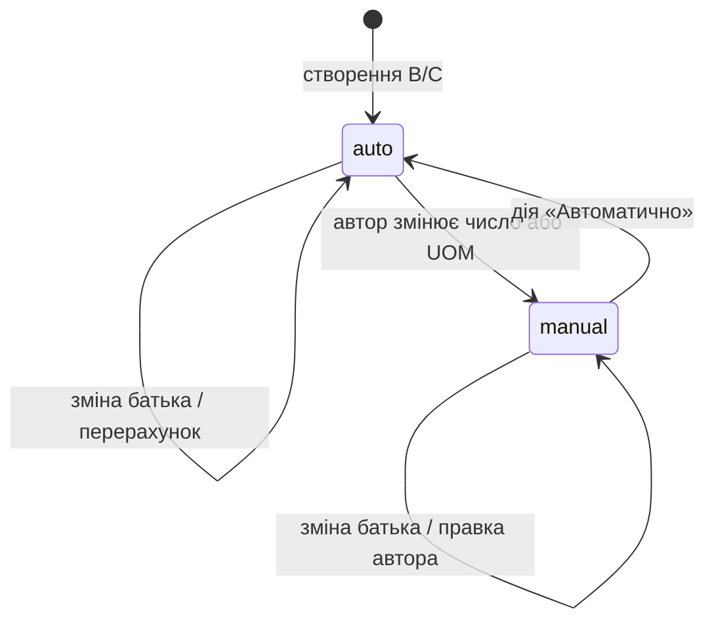
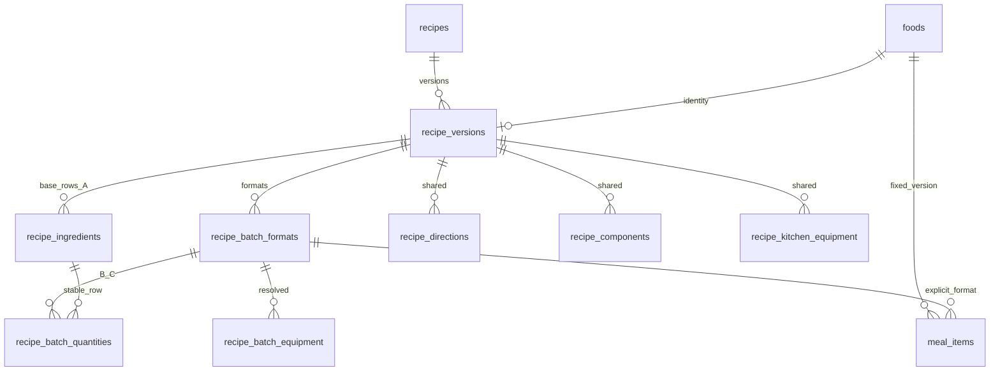
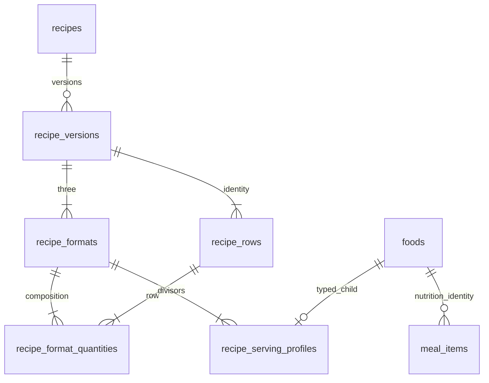

# Stage 3: архітектурний контракт редактора рецептів із трьома форматами

> **PROPOSAL — NOT APPROVED**
>
> Це пропозиція для окремого погодження, а не зміна чинної схеми чи дозвіл на реалізацію.
> Усі нові назви таблиць, колонок, алгоритми, пороги та UX-рішення нижче — запропоновані.
> Продуктова концепція походить із завдання власника; затвердження технічного контракту — окремий крок.

## 1. Підстава, межі та перевірені джерела

Базу аналізу зафіксовано 24.10.2026: GitHub `master`, commit
`e6c12ccf006e379714c1695e4e5ec9e8ee8a0b89`, звірений через GitHub API з локальним checkout.
Це вихідний commit аналізу, а не постійне твердження про найновіший стан проєкту.
Статуси робіт залишаються у [roadmap](../roadmap.md), факти реалізації — у
[project-status](../project-status.md). Stage 3, T1.5 і DEC-3B цим документом не закриваються.

Прочитані [AGENTS.md](../../AGENTS.md), roadmap і project-status; предметні джерела:

| Джерело | Висновок для контракту |
|---|---|
| [SQL 01](../01_nutrition_schema.sql) | Один `recipe_versions.food_id`, один набір `*_per_serving`, `servings_count`; склад на одну порцію. Публікація — UPDATE, незмінність захищено тригерами. |
| [DBML](../database.dbml), [Entity Catalog](../entity-catalog.md), §3–4, §8, §11 | Логічна картка окрема від версії; один супертип `foods`; компоненти, інструкції й обладнання належать версії; списки покупок без власних таблиць. |
| [Business Rules](../business-rules.md), BR-F-08…22, BR-P-05/14, BR-X-01…09 | Один draft, незмінність published, одна порція як чинна база; нові формати потребують явних уточнень правил, перелічених у §2. |
| [Schema Audit](../schema-audit.md), §3, §5.3, §7.7 | `quantity_grams` перевіряється при публікації; поточні довідники можуть змінюватися. Оновлення draft після зміни довідників досі не погоджене. |
| [Nutrition migration](../../database/migrations/2026_10_21_000200_create_nutrition_schema.php), [виконуваний SQL](../../database/sql/stage1/01_nutrition_schema.sql) | Міграція завантажує окремий знімок Stage 1. Відмінності від docs SQL — обгортка транзакції/extension і погоджений BIGINT `created_by`; новий контракт не можна вносити редагуванням цього знімка. |
| [t01](../../tests/pg/t01_foods.sql), [t02](../../tests/pg/t02_recipes.sql) | Перевірено контракт food/нащадок, UOM, один draft, публікацію, грамування, захист дочірніх рядків, нову версію без заміни старого food, складений FK компонента. |
| [t03](../../tests/pg/t03_plans.sql), [t04](../../tests/pg/t04_assignments.sql) | Recipe item — тільки `serving`/NULL grams; T3.16–24 перевіряють грамування, зміну конверсії та незмінність плану; призначення — конкретна published-версія, EXCLUDE дат. |
| [BusinessSchemaTest](../../tests/Postgres/BusinessSchemaTest.php) | Виконує SQL-сценарії й звіряє каталог з еталоном. Майбутнє розширення потребує окремого baseline/upgrade покриття, а не просто заміни очікуваної кількості таблиць. |
| [Архітектура](../architecture.md) | PostgreSQL 18, Laravel, Filament 5; поточна панель доступна admin. Окремий SPA редактора та нові залежності не потрібні. |

Сервіс редактора/публікації й модуль раціонів ще не реалізовані. Наявні SQL-тести не перевіряють нові формати, точність обчислення КБЖВ сервісом, токени чи каскад. Історичні PASS не є результатом перевірки цього контракту.

У цьому PR: лише цей документ і навігаційне посилання з roadmap. Немає UI, PHP-сервісів, імпорту, міграцій, виконуваного SQL, змін залежностей або операцій із БД. SQL нижче — псевдо-DDL для review.

## 2. Чинні правила та запропоновані уточнення

| Правила | Чинний контракт | Пропозиція після окремого затвердження |
|---|---|---|
| BR-F-08, BR-X-07 | Максимум один draft на логічний рецепт; прямий published INSERT заборонений | Зберегти. Три формати — діти одного draft, без власних статусів. |
| BR-F-09/10 | Один food, один набір КБЖВ на порцію, `servings_count > 0` | Зберегти food як ідентичність версії. Старі КБЖВ — сумісне представлення A; додати totals форматів і явний дільник споживання. |
| BR-F-11 | Опубліковані склад/КБЖВ незмінні | Зберегти й розширити на всі формати та snapshots. Поведінка draft при зміні довідника — **відкрите DEC-3B**, запропоновано в §9. |
| BR-F-12, BR-X-06 | `recipe_ingredients` на одну порцію | Зберегти цю семантику для A/legacy; B/C зберігати фактичними фізичними партіями в новій таблиці. Універсальне правило «всі кількості на порцію» доведеться уточнити. |
| BR-F-13/14 | Дозволені UOM; round(quantity × поточна конверсія, 2) при публікації | Зберегти, поширити на B/C; для A нових версій дозволити тільки `g`. Після публікації читати frozen grams і конверсію, а не перевіряти проти нового довідника. |
| BR-F-15/16, BR-X-01/02/04 | Незмінні published, нова версія/новий food, персональна CoW-копія | Зберегти. До захисту включити нові дочірні таблиці й усі зв'язки формату. |
| BR-F-17/18/19 | `parent_recipe_id`, одна nullable-категорія, компоненти в межах версії | Зберегти; рядок інгредієнта/компонент спільний для A/B/C. M:N-категорій не пропонуємо. |
| BR-F-20/21/22 | Спільні кроки/токени, `fixed/proportional` обладнання, сервісна перевірка | Уточнити контекст формату для токенів та масштабування обладнання. У SQL `min_value` nullable, CHECK лише для ненульового значення: не вимагати його всюди без нового рішення. |
| BR-P-05, BR-X-03 | Один `food_id`; рецепт тільки `serving`, grams NULL | Зберегти тип позиції та одиницю; додати необов'язкове legacy-сумісне посилання на формат і дільник. |
| BR-P-14 | Масштабування через `recipe_versions.servings_count` | Для нових версій замінити на явні формат/дільник/кількість порцій; legacy читати за старим контрактом. |
| BR-X-05 | Один frozen набір КБЖВ на порцію | Frozen totals трьох фізичних форматів і чотири способи обчислення порції, без вимоги їх рівності. |
| BR-S-01…03 | Списки покупок обчислюються, нових shopping-таблиць немає | Зберегти. Рецептурна партія й закупівельне округлення списку — різні операції. |

У Entity Catalog §3 є неоднозначне речення про зміну відображуваних КБЖВ при повторному розрахунку історичного рецепта. SQL і BR-F-11 мають пріоритет: історичний показ повинен читати frozen `*_per_serving`, не суму актуального довідника. Цим PR канонічні джерела не переписуються; усунення формулювання включити до погодженої forward-ревізії.

## 3. Продуктовий контракт

Пріоритет — зручно придбати й відміряти продукти. Різні КБЖВ між форматами допустимі.

| Формат | Код | Початкове наповнення | Редагування | Порція |
|---|---|---|---|---|
| A: одна порція | `single` | Автор вводить кількості | Лише грами, ручна база | Total A / 1 |
| B: сім порцій | `week` | Фактична A × 7 | Auto або manual, дозволена UOM | Total B / 7 |
| C: півтижнева партія | `half_week` | Фактична B / 2 | Auto або manual, дозволена UOM | Той самий Total C / 3 **або** / 4 |

C не має єдиного `servings_count = 3.5` для КБЖВ. `3.5` — тільки технічний коефіцієнт масштабування обладнання від A; фізичний склад C один. Для двох приготувань C загальна тижнева цінність дорівнює `2 × Total C`, навіть якщо першу партію їдять три дні, а другу — чотири.

Приклади з умови — ілюстративні, не Excel-дані: 150 г курятини → 1050 г B → 525 г C; правка B до 1000 г дає auto C=500 г; manual C=600 г зберігається після зміни A до 160 г. 420 г горошку B можна замінити на 1 банку лише після визначення їстівних грамів цієї банки. Жодної прив'язки до калорійної «цілі» та оптимізатора закупівель у v1.

Склад інгредієнтів спільний: три формати мають той самий набір рядків та ingredient_id. У v1 немає заміни курятини іншим продуктом лише у B або опціональних нульових рядків C. Зміна продукту — структурна зміна всього рецепта (§4). Це обмеження також потребує погодження.

## 4. State machine та ідентичність рядка

Один атомарний стан `mode` керує парою **(quantity, uom_id)** у B/C. Не вводимо незалежні режими для числа та UOM: зміна будь-якого з них робить всю пару manual. `quantity_grams`, mathematical target і КБЖВ завжди обчислювані; їх не можна ручно перевизначати. A не має перемикача режиму.



Окрема ознака `needs_review` не є третім режимом. Вона може існувати і при auto (наприклад, зникла конверсія), і при manual. Рівність manual чисельно auto не переводить режим назад: потрібна явна дія.

| Подія | A | B | C |
|---|---|---|---|
| Змінити A | Зберегти нові грами | Перерахувати тільки auto | Перерахувати auto з **фактичного** B, навіть якщо B manual |
| Змінити B вручну | Без змін | Пара стає manual | Auto перерахувати з нового B; manual захищене |
| Змінити C вручну | Без змін | Без змін | Пара стає manual |
| «Автоматично» у B | Без змін | Видалити override, негайно взяти актуальний auto результат | Перерахувати лише auto C |
| «Автоматично» у C | Без змін | Без змін | Взяти половину поточного фактичного B та застосувати policy |
| Змінити UOM | Для A недоступно | Manual; показати грамовий еквівалент до підтвердження | Аналогічно B |

Повернення в auto показує попередній і новий результат; відміна до збереження можлива. Не використовувати NULL як неявну ознаку auto. Повторне введення того самого числа є manual лише після підтвердженої користувацької зміни, а не focus/blur/hydration callback.

### 4.1. Структурні зміни

- Рядок має стабільний PK `recipe_ingredients.id`; повторний продукт у різних компонентах дозволений. Ідентифікація за ingredient_id або позицією масиву заборонена.
- Додавання: одна команда створює A та B/C auto в одній транзакції. До валідного числа A показуємо порожні похідні поля, а не нулі; незавершене введення існує тільки у стані форми.
- Видалення: показати наслідки для трьох форматів, ручних значень і токенів. Видалити B/C та A атомарно після виправлення посилань; RESTRICT не дозволяє тихого каскаду. Нове додавання такого самого ingredient_id отримує новий row ID.
- Заміна ingredient_id: команда створює новий рядок замість старого; зберігає видимі грами A лише після підтвердження. Попередні manual числа/UOM B/C **не переносяться** на інший продукт; нові B/C auto. До підтвердження — preview втрати override. Токени мають бути явно переприв'язані або видалені.
- Переміщення/зміна компонента/порядку не скидає режими. Спільний component_id має належати тій самій версії.
- Немає auto-видалення ручного дочірнього рядка при очищенні поля A: збереження відхиляє неповний агрегат, UI дозволяє завершити або скасувати правку.

### 4.2. Виявлення застарілих ручних значень

Коли автор задає/підтверджує manual, зберігається `manual_context`: кількість A у грамах, фактичні грами безпосереднього батька, ingredient fingerprint, conversion fingerprint, policy version. `review_ack_hash` фіксує підтвердження конкретного стану. Після наступної зміни старе підтвердження не діє.

Пропоновані критерії: будь-яка зміна конверсії/харчових даних/семантики продукту; для кількісних правок — ≥20% зміни A або безпосереднього батька від останнього підтвердженого контексту. Порівняння з A потрібне також для C, якщо manual B залишилося незмінним. Поріг 20% — **не затверджений**, див. D4. Зміна токенів/складу вимагає окремого review інструкцій.

Значення зберігається, UI показує причину й delta. «Підтверджую» оновлює контекст, «Автоматично» скидає manual; жодна з цих дій не виводиться автоматично з рівності чисел. Для суттєвих відхилень достатньо підтвердження — вирівнювати КБЖВ не потрібно.

### 4.3. Відновлення та одночасне редагування

Сервер повертає збережені quantity, UOM, mode, grams, policy snapshot, fingerprints, review acknowledgements і `lock_version`. Відкриття форми не запускає user-change події і не переписує auto/manual. Повторний розрахунок auto з тими самими inputs/policy має бути ідемпотентним; невідповідність — помилка цілісності/попереднього алгоритму, яку видно автору.

Граф залежностей фіксований: A→B→C→totals→порівняння. Немає C→B, totals→quantity або автоматичного зворотного перерахунку A з manual B. Одна команда проходить граф один раз; серверні результати застосовуються як hydration, не нові команди.

У межах вкладки команди впорядковані `client_sequence`; застарілі preview-відповіді ігноруються. Для збереження передається очікуваний `lock_version`; дві вкладки не зливаються за принципом last-write-wins. Конфлікт повертає поточний агрегат і локальну правку для повторного застосування. Зміна одного рядка все одно блокує версію агрегату.

## 5. Одиниці, точність та правила зручності

### 5.1. Три послідовні операції

1. **Математика:** target grams B=`A.quantity_grams × 7`; target grams C=`B.quantity_grams / 2`. C використовує B після округлення або manual. Немає округлення між математичними операціями.
2. **Auto policy:** вибір дозволеної UOM, конверсія target grams у quantity, потім допустиме округлення quantity. UI показує target і результат, наприклад «1.5 шт. → 2 шт., округлено вгору».
3. **Manual:** автор задає пару quantity/UOM; policy не округлює її. Лише перевірка допустимої дробової частки й точності; невалідне число відхиляється з поясненням.

Auto unit у B: дозволена `ingredient_uoms.is_default`, якщо налаштована та придатна policy; інакше `g`. Auto unit у C успадковує фактичну UOM B. Якщо вона недоступна, потрібне явне виправлення/refresh; не підміняти одиницю manual. Авторське ручне переведення C у грами робить C manual. Зміна policy не змінює збережені результати без явного preview застосування.

### 5.2. Розширюваний v1 policy

Версійований Laravel resolver без таблиць `shopping_rounding_rules`/`ingredient_purchase_rules`. Порядок: explicit ingredient override у конфігурації → category default → UOM default → точні грами. Продуктові ID/коди та початкові дані довідників потребують T1.5; не припускати, що «банка» чи «упаковка» вже seeded.

Незмінний JSON snapshot обраного правила на B/C містить `policy_version`, `rule_key`, `preferred_uom_id`, `allowed_step`, `rounding` (`none/ceil/nearest`), `gram_step` та `origin`. Ключі валідовані за схемою resolver; не довільні executable вирази. Це знімок правила редактора, не сховище shopping lists.

| Випадок | Пропоноване auto-правило | Ручне редагування |
|---|---|---|
| Штучний продукт | `ceil(q / 1) × 1` | Можна перейти на g; дробові штуки лише якщо дозволені для цього ingredient/UOM |
| Банка/упаковка | Дозволений крок, наприклад 1 або 0.5; без узгодженого правила — g | 0.5 пачки лише якщо дозволено; це не загальне правило для всіх упаковок |
| М'ясо/риба | Опційний `nearest` до 100 г, tie вгору; за замовчуванням точні g | Довільні допустимі грами. 1050→1000 у контрольному сценарії — саме manual |
| Крупи | Точні g, з технічною точністю 0.01 г | Точне зважування |

Округлення м'яса до 100 г не застосовується глобально: інакше початковий приклад 1050/525 г став би іншим. Вмикається явним правилом із preview; direction nearest/ceil затверджується D3. Якщо auto-результат нульовий або завеликий, показати помилку; не підставляти 0.01 г чи інший прихований мінімум.

### 5.3. Грами та їстівна маса

Додаткова UOM дозволена тільки за наявності чинного `ingredient_uoms` із додатною скінченною конверсією. `g` — неявний множник 1. `serving` не є одиницею рядка інгредієнта.

`grams_per_uom` для банки/пачки в рецептурі означає **їстівні грами фактично використаного продукту** на одиницю. 400 г нетто банки з 240 г горошку після зливання — не 400 г інгредієнта. Це ілюстрація, не дані бази. Нерозрізнені SKU/конверсії не можна виправляти «магічним» коефіцієнтом. Для v1 треба затвердити конкретне значення/опис UOM; повний каталог упаковок, yield і оптимізація покупок відкладаються.

Параметр `allowed_step` регулює авторську дробову частку, а `gram_step` — лише auto-зручність: 100 г у policy не забороняє автору 1050 г. Перехід «штуки/банки → g» пропонує поточний frozen грамовий еквівалент без зміни маси; автор може змінити його. Якщо нова конверсія pending, спершу вибрати стару зафіксовану масу в g або прийняти нову конверсію.

### 5.4. Числова дисципліна

Decimal arithmetic на сервері; JSON decimal як рядки, без binary float. Зберегти для фактичних кількостей/грамів `numeric(7,2)` як у baseline (верхня межа 99999.99), не розширювати історичні поля в цій пропозиції. Відхиляти NaN/Infinity та понад два знаки у manual — не тихо округлювати введене число.

`quantity_grams = round(quantity × factor_snapshot, 2)`; для g quantity дорівнює grams. Auto-кількість приводиться до дозволеного кроку/двох знаків тільки наприкінці. Для невідтворюваної точності обраної UOM показати похибку й запропонувати g. Фактичні грами можуть відрізнятися від математичної цілі — КБЖВ завжди за фактичними. PostgreSQL round positive numeric: половини вгору; та сама семантика на сервері й у preview.

## 6. Контракт UX у Filament 5

Одна сторінка версії рецепта: спільні назва/категорія, компоненти, таблиця інгредієнтів, кроки й обладнання. Desktop-таблиця: «Інгредієнт / компонент» + групи A/B/C; кожна група має quantity, UOM, grams та КБЖВ рядка за потреби розгортання. A показує фіксовану `г`. B/C мають текстові бейджі «Автоматично»/«Вручну», пояснення округлення й дію «Автоматично». Колір — додатковий сигнал, не єдиний.

Оновлення попереднього розрахунку після валідного введення з коротким debounce; до відповіді показувати «Обчислення…». Проміжні `1,`/порожнє поле не перетворюються на 0 і не записуються в БД. Сервер — авторитет; Save/Publish доступні лише після завершення актуального preview. Усі три форми зберігаються однією дією, без незалежних Save для B/C.

Панель КБЖВ показує чотири порції: A/1, B/7, C/3, C/4, а також totals A/B/C. Тижневе порівняння — B проти `2×C` окремо для ккал/білків/жирів/вуглеводів, абсолютна і відсоткова різниця. Для нульового знаменника — абсолютна різниця та «немає бази для %», не ділення на нуль.

Пропоновано попереджати про ≥10% різниці для будь-якого макропоказника між B/7 та A або між `2×C` та B; порції C/3 та C/4 показувати завжди, їхню закономірну різницю не трактувати як дефект. Пороги/абсолютні мінімальні delta — D4, не правило рівності. Будь-яке допустиме відхилення можна підтвердити.

Перед спільною публікацією — review усіх форматів: відсутні UOM, помилки грамування, incomplete rows/токени, pending ingredient updates, ручні значення з needs_review, nutrition deviations, обладнання/місткість. Помилки цілісності блокують; змістовні попередження потребують підтвердження саме поточної revision. Немає вимоги виправити КБЖВ до однакових. Кнопка одна: «Опублікувати всі формати».

На 320/390 px таблиця стає картками рядків із перемикачем A/B/C на тій самій сторінці; назва продукту й ознаки manual/needs_review інших форматів лишаються видимі. Підсумки — компактні картки з усіма чотирма дільниками, review доступний без горизонтального прокручування. Перемикання не скидає введення. Keyboard labels, повідомлення про конфлікти й помилки прив'язані до рядка/формату; фокус переходить до першої помилки. Конкретні компоненти Filament перевірити spike у T3.3, без нового frontend framework.

## 7. Альтернативи фізичної моделі

### 7.1. Модель I: нормалізовані формати одного агрегату — рекомендовано



A залишається в чинній `recipe_ingredients`; вона також ідентифікує спільний рядок. Нова таблиця B/C не дублює A. Три format headers містять totals і policy; `meal_items` зберігає той самий food та опційний format/divisor. Переваги: один draft/status/version/набір текстів, нормальні FK, мінімальний вплив на food-supertype, історичні дані лишаються на місці. Ризики: гібридний read A проти B/C; обов'язкові deferred aggregate checks і context-aware Stage 4. Усі споживачі нових версій мусять знати формат, сам food більше не є повним nutrition selector.

### 7.2. Модель II: повністю уніфіковані format rows + food для способу порціонування



Serving profiles A/1, B/7, C/3, C/4 дали б **чотири food**, хоча фізичних складів три. Просто три food недостатньо: C/3 і C/4 мають різне КБЖВ. Переваги: food однозначно задає порцію, `meal_items` майже не змінюється; рівномірна таблиця кількостей. Ризики: новий типізований нащадок `recipe_serving_profile` або зміна значення `recipe_version` у `foods`; переробка CHECK, deferred `check_food_has_child`, FK, `validate_food_measure`, пошуку каталогу; перенесення старого A та snapshot history. Чотири food не повинні створювати чотири логічні картки в пошуку. Більша міграційна поверхня для v1; не рекомендовано.

### 7.3. Інші мінімальні варіанти

| Варіант | Перевага | Чому не обрано |
|---|---|---|
| B/C як JSON у `recipe_versions` | Мало таблиць | Складні FK на UOM/рядки, часткові оновлення, аудит і конкурентність; ризик прихованої втрати режимів. JSON доречний тільки для policy/provenance. |
| Три `recipe_versions` або три `recipes` | Працюють старі food-зв'язки | Дублює картку/інструкції, порушує один draft і спільну публікацію; C/3 і C/4 все одно не розв'язано. |
| Тільки snapshot КБЖВ у `meal_items` | Зберігає результат обчислення | Не визначає фізичний склад для кроків/покупок; без format/divisor походження неоднозначне. Можливий додатковий кеш, не заміна посилання. |
| Format code + divisor без FK у meal_items | Менше join | Неможливо FK гарантувати належність формату конкретній версії; усе доводиться тригерами. Обрано числовий FK зі складеною перевіркою власника. |

## 8. Рекомендована схема: точний інвентар змін

### 8.1. Що залишається

Без видалення/перейменування залишаються всі чинні таблиці та колонки: `foods`, `ingredients`, `ingredient_uoms`, `uoms`, `recipes`, `recipe_versions`, `recipe_ingredients`, `recipe_components`, `recipe_directions`, `recipe_kitchen_equipment`, довідники категорій/обладнання, всі таблиці планів/призначень. PK/FK та індекси baseline зберігаються.

Для нових batch-версій `recipe_versions.servings_count=1`, `*_per_serving` дублює тільки A/1 для сумісності. Воно не є джерелом B/C. Legacy `servings_count` і КБЖВ не змінюються. `recipe_ingredients.quantity/uom_id/quantity_grams` лишаються A на одну порцію. Немає UNIQUE на ingredient_id: повторні рядки допустимі.

### 8.2. Запропоновані доповнення

У нових колонок metadata старих рядків nullable/default так, щоб не переписувати published-content:

| Об'єкт | Нові колонки / призначення |
|---|---|
| `recipe_versions` | `editor_contract text NOT NULL DEFAULT 'legacy_v1' CHECK IN ('legacy_v1','batch_v1')`; `lock_version bigint NOT NULL DEFAULT 0 CHECK >=0`; `publication_review jsonb NULL` (object: revision hash, підтвердження, actor/time); `source_recipe_version_id integer NULL FK RESTRICT` для походження копії/версії, CHECK не self |
| `recipe_ingredients` | `ingredient_snapshot jsonb NULL`: name, чотири decimal КБЖВ/100 г, ingredient fingerprint, conversion=1 для A, UOM label, schema version. Для batch_v1 обов'язковий; старі рядки NULL, не вигадувати історичні дані. |
| `recipe_batch_formats` | `id integer identity PK`, `recipe_version_id integer NOT NULL FK RESTRICT`, `code text NOT NULL CHECK IN ('single','week','half_week')`, `policy_snapshot jsonb NOT NULL`, чотири `*_total numeric(14,6) NOT NULL CHECK >=0`, `calculation_hash text NOT NULL`; UNIQUE(version,code), UNIQUE(id,version). Немає food/status/дільника C. |
| `recipe_batch_quantities` | `recipe_version_id`, `format_id`, `format_code` (тільки week/half_week), `recipe_ingredient_id`; `mode text NOT NULL CHECK IN ('auto','manual')`; `quantity numeric(7,2)`, `uom_id smallint`, `quantity_grams numeric(7,2)` — NOT NULL, >0; `input_snapshot jsonb NOT NULL` (ingredient, factor, UOM label, parent target, applied rule, fingerprints); `manual_context jsonb NULL`; `review_ack_hash text NULL`. PK(format_id,recipe_ingredient_id). |
| `recipe_batch_equipment` | `recipe_version_id`, `format_id`, `recipe_kitchen_equipment_id`, `mode auto/manual`, `min_value numeric(7,2) NULL CHECK >0`, `uom_id smallint NULL FK RESTRICT`, `tip text NULL`, `input_snapshot jsonb NOT NULL`, `manual_context jsonb NULL`, `review_ack_hash text NULL`; PK(format_id,recipe_kitchen_equipment_id). Розрахований snapshot для кожного з A/B/C; nullable min_value зберігає baseline семантику. |
| `meal_items` — **майбутня Stage 4 міграція** | `recipe_version_id integer NULL`, `recipe_batch_format_id integer NULL`, `recipe_portion_divisor smallint NULL`; усі три NULL для legacy/інгредієнта або всі NOT NULL для batch-рецепта. `food_id`, `quantity`, `uom_id`, grams не змінюють семантики. |

Snapshots — валідовані object зі schema version; числа у JSON — decimal strings. Це обмежені знімки джерел, не альтернативне JSON-сховище складу. `needs_review` обчислюється з fingerprints/ack, не зберігається як прапорець, що може застаріти. Поточні draft totals/grams — відтворюваний кеш, при публікації стають frozen даними. На чотири пер-порційні КБЖВ окремих колонок/таблиць немає.

### 8.3. Псевдо-SQL зв'язків і перевірок

```sql
-- ПРОПОЗИЦІЯ; НЕ МІГРАЦІЯ. Перелік колонок/типів — у §8.2.
ALTER TABLE recipe_ingredients ADD UNIQUE (id, recipe_version_id);
ALTER TABLE recipe_kitchen_equipment ADD UNIQUE (id, recipe_version_id);
ALTER TABLE recipe_versions ADD UNIQUE (id, food_id);

-- recipe_batch_formats:
UNIQUE (recipe_version_id, code);
UNIQUE (id, recipe_version_id);
UNIQUE (id, recipe_version_id, code);
FOREIGN KEY (recipe_version_id) REFERENCES recipe_versions(id) ON DELETE RESTRICT;

-- recipe_batch_quantities:
PRIMARY KEY (format_id, recipe_ingredient_id);
CHECK (format_code IN ('week', 'half_week'));
CHECK (mode IN ('auto', 'manual'));
CHECK (quantity > 0 AND quantity_grams > 0);
CHECK ((mode = 'manual' AND manual_context IS NOT NULL)
    OR (mode = 'auto' AND manual_context IS NULL));
FOREIGN KEY (format_id, recipe_version_id, format_code)
  REFERENCES recipe_batch_formats(id, recipe_version_id, code) ON DELETE RESTRICT;
FOREIGN KEY (recipe_ingredient_id, recipe_version_id)
  REFERENCES recipe_ingredients(id, recipe_version_id) ON DELETE RESTRICT;
FOREIGN KEY (uom_id) REFERENCES uoms(id) ON DELETE RESTRICT;

-- recipe_batch_equipment:
FOREIGN KEY (format_id, recipe_version_id)
  REFERENCES recipe_batch_formats(id, recipe_version_id) ON DELETE RESTRICT;
FOREIGN KEY (recipe_kitchen_equipment_id, recipe_version_id)
  REFERENCES recipe_kitchen_equipment(id, recipe_version_id) ON DELETE RESTRICT;

-- meal_items, лише в майбутній Stage 4:
CHECK ((recipe_version_id IS NULL AND recipe_batch_format_id IS NULL
        AND recipe_portion_divisor IS NULL)
    OR (recipe_version_id IS NOT NULL AND recipe_batch_format_id IS NOT NULL
        AND recipe_portion_divisor IS NOT NULL
        AND recipe_portion_divisor IN (1, 3, 4, 7)));
FOREIGN KEY (recipe_version_id, food_id)
  REFERENCES recipe_versions(id, food_id) ON DELETE RESTRICT;
FOREIGN KEY (recipe_batch_format_id, recipe_version_id)
  REFERENCES recipe_batch_formats(id, recipe_version_id) ON DELETE RESTRICT;
```

Міжтабличні правила не можна удавати простими CHECK. Потрібні constraint triggers `DEFERRABLE INITIALLY DEFERRED` на агрегаті: для batch_v1 рівно три headers, кожен A-row має рівно два B/C-рядки; жодного додаткового/чужого рядка; legacy не має batch headers. На Save транзакція може тимчасово не мати повної трійки; на COMMIT вона повна. Всі зміни деталей спершу блокують версію.

Публікаційний тригер додатково перевіряє A в g, conversion/grams усіх рядків, schema snapshots, totals і `auto` відповідність frozen policy/батьку. Сума snapshots має дорівнювати totals; manual не зобов'язане дорівнювати target. Для equipment — повне покриття трьох headers і валідні nullable пари; якщо baseline не має числового min_value, формат теж не вигадує його.

Додаткові індекси: quantities `(recipe_ingredient_id)`, `(recipe_version_id)`, `(uom_id)`; equipment `(recipe_version_id)`, `(recipe_kitchen_equipment_id)`, `(uom_id)`; versions `(source_recipe_version_id)`; Stage 4 meal_items `(recipe_batch_format_id)`, `(recipe_version_id,food_id)`. UNIQUE(version,code) покриває пошук headers версії, PK quantities починається з format_id. Індекси fingerprints/GIN на JSON у v1 не потрібні. Усі посилання RESTRICT; видалення draft — явна транзакція від деталей до кореня, published заборонене навіть без зовнішніх посилань.

## 9. Алгоритм кількостей, КБЖВ та зміна довідників

### 9.1. Єдиний deterministic evaluator

```text
evaluate(aggregate, accepted_input_snapshot, policy_snapshot):
  validate complete positive A rows in g
  for row in stable row order:
    A.grams = A.quantity
    B.target_grams = A.grams * 7
    B.actual = B.manual_pair OR policy(B.target_grams)
    B.grams = round(B.actual.quantity * accepted_factor(B.uom), 2)
    C.target_grams = B.grams / 2
    C.actual = C.manual_pair OR policy(C.target_grams, inherited_uom=B.uom)
    C.grams = round(C.actual.quantity * accepted_factor(C.uom), 2)
    mark review reasons from changed fingerprints/contexts
  each format total = sum(actual row grams / 100 * snapshot nutrient_per_100g)
  persist totals at 6 decimal places; per-serving display = round(total / divisor, 2)
  compare B.total with 2 * C.total; never feed result back into quantities
```

За baseline grams і nutrient/100g мають по два знаки, тому внесок рядка має максимум шість знаків: `numeric(14,6)` totals та більша проміжна decimal-точність не втрачають суму. Перевіряти overflow окремо на рядку, сумі та сумісному A `numeric(7,2)`; відмова, а не обрізання.

Legacy/A compatibility `recipe_versions.*_per_serving = round(single.*_total,2)`. Перегляд і Stage 4 для batch використовують totals та divisor, без множення вже округленого пер-порційного числа. Наприклад, `3×round(C/3,2)` може відрізнятися від C на 0.01; підсумки рахуються до display rounding. КБЖВ включає всі фактично використані інгредієнти; не підганяється формулою 4/9/4 до kcal довідника.

### 9.2. BR-F-11 / DEC-3B: запропонована політика draft refresh

**Це рішення не затверджене.** Рекомендовано не перезаписувати чернетки фоновим job після кожної довідникової зміни. На open, explicit refresh, Save і Publish порівнювати fingerprint харчових даних, конверсій, default UOM і policy зі snapshot draft. Виявлена зміна дає pending diff; сам open не записує дані. Save із непідтвердженим diff відхиляється як конфлікт джерел зі збереженням локальних правок у формі.

Автор обирає «Оновити дані» з preview. A грами незмінні. Auto B/C перераховуються; manual **quantity/UOM** не змінюються. Нова конверсія змінює grams і КБЖВ manual-пари тільки після явного прийняття diff. Альтернатива — перейти на g зі старою масою, що фіксує авторський намір. Зміна ingredient nutrition не змінює quantity/grams, лише КБЖВ; знову потребує review. Після refresh нові fingerprints/контексти та totals зберігаються атомарно.

Якщо конверсію видалено, зберегти старі snapshot/пару для пояснення, але нову публікацію блокувати. Автор обирає g або дозволену UOM; старі опубліковані версії не блокуються й не перераховуються. Зміна default UOM впливає лише на auto після підтвердженого refresh, manual захищене.

Публікація вимагає прийняті **актуальні** inputs: не дозволяє публікувати стару конверсію, маскуючи її snapshot. Це зберігає BR-F-14. При одночасній зміні довідника перевірка/блокування в §10 усуває розрив між preview і publication.

## 10. Збереження, публікація, версійність і CoW

### 10.1. Транзакція збереження

Команда містить expected revision і авторські intents, а не довільні клієнтські totals. Порядок блокувань спільний для всіх сервісів: логічний `recipes` → `recipe_versions` → використані `ingredients` за ID → їх `ingredient_uoms` за складеним ключем → деталі. Version lock серіалізує редагування/публікацію. Ingredient `FOR SHARE` блокує зміну nutrition; existing conversion `FOR SHARE` блокує UPDATE/DELETE. Щоб закрити INSERT phantom нової default UOM, всі зміни ingredient_uoms повинні спершу брати `FOR UPDATE` відповідного ingredient: потрібен DB-trigger цього lock-протоколу, а не лише домовленість Laravel. Старі published reads не беруть ці locks.

Після locks перевірити status=draft, `lock_version`, fingerprints і права. Перерахувати на сервері, перевірити всі режими/grams; записати всі три формати, snapshots та review context; підняти revision на 1. Constraint checks на COMMIT. Будь-яка помилка відкочує весь агрегат. Відповідь повертає canonical state і нову revision. Сліпий повтор після timeout не застосовує правку вдруге: стара expected revision повертає conflict; клієнт спершу перечитує.

У v1 не дозволяємо direct table writes прикладній ролі в обхід команди; DB тригери додатково блокують корінь при зміні OLD/NEW дочірніх зв'язків. Оскільки базова `recipe_ingredients` теж може змінитися, guards/evaluator інваріанти мають охопити й A, не лише нові таблиці.

### 10.2. Атомарна публікація

1. Взяти locks у тому самому порядку, звірити expected revision, status та accepted inputs; якщо щось змінилося після review — повернути новий preview, не публікувати.
2. Перевірити повну трійку форматів, позитивні кількості, дозволені UOM, grams, snapshots, totals, auto graph, компоненти, токени, equipment та обов'язковість полів за чинним BR-F-22. Відхилення КБЖВ само по собі не помилка.
3. Перевірити всі acknowledgements за hash саме поточного складу/inputs/policy. Зафіксувати `publication_review` (revision/hash, author, час, підтверджені причини) до заморожування.
4. Виділити version_number під lock логічного рецепта; UNIQUE(recipe_id,version_number) і recipe_one_draft лишаються. Створити **один** foods з типом recipe_version.
5. Записати A compatibility macros, `food_id`, `version_number`, `published_at` і виконати UPDATE draft→published. Deferred food-child trigger на COMMIT бачить одну published-версію. Всі формати стають immutable одним статусом кореня.

Не додавати окремих статусів/часів публікації B/C і не створювати foods під час звичайного Save. Повторний Publish після успішної публікації повертає вже створену версію при збігу hash або conflict, без другого food.

### 10.3. Сумісність із тригерами PostgreSQL

`food_has_child_after_insert`, складені food FK, `reject_direct_published_insert`, `guard_recipe_version`, guards плану/призначень залишаються з чинною семантикою. Не відключати їх для backfill. `validate_recipe_publication` у **новій forward-міграції** матиме branch legacy/batch: legacy перевіряється як раніше, batch — додатково за §8–10. `guard_recipe_detail` поширюється на нові таблиці; при UPDATE перевіряє і OLD, і NEW version_id, забороняючи перенесення до/з published. Непрямі FK до формату теж потребують цього guard.

Stage 4 доповнює `validate_food_measure`/`guard_meal_item_measure` та фінальний `validate_plan_publication` контекстною перевіркою format/divisor. Старий `validate_food_measure(food,uom,grams)` лишається базовою перевіркою; новий wrapper перевіряє всю позицію. Одних FK недостатньо: перевіряються code→divisor і branch editor_contract. Всі published plan detail guards продовжують захищати і нові колонки.

### 10.4. Нова версія і персональна копія

Нова версія того самого рецепта: клон агрегату у draft з новими child PK, всі три формати/режими/policy копіюються; food/version_number/published_at очищаються. Tokens та component/equipment links remap через карту старих/нових ID. Копіювання не скидає manual в auto. `source_recipe_version_id` фіксує джерело, fingerprints звіряються з актуальними довідниками; refresh перед публікацією обов'язковий при змінах.

CoW: нова `recipes` з `parent_recipe_id` та owner, новий draft з тими самими правилами клонування й `source_recipe_version_id`. Жодних `custom_*` у meal_items. Самопосилання й цикли lineage забороняє сервіс; FK/CHECK self у БД. Копіюємо тексти, не посилаємося на mutable draft іншого рецепта. Старі foods, плани та assignments не змінюються.

## 11. Контракт Stage 4: food, формат, порція і фізичне приготування

**Обрано для погодження модель I.** Recipe food ідентифікує конкретну published-версію. Для batch_v1 повний selector:
`(food_id, recipe_version_id, recipe_batch_format_id, recipe_portion_divisor)`.

| Тип meal item | Нові посилання | Одиниця/грами | Розрахунок |
|---|---|---|---|
| Ingredient | Всі NULL | Чинні дозволена UOM і grams >0 | Чинний контракт інгредієнта |
| Legacy recipe | Всі NULL | `serving`, grams NULL | frozen `recipe_versions.*_per_serving × quantity`; старе масштабування без змін |
| Batch A | Всі задані, code=single, divisor=1 | `serving`, grams NULL | `single.total × quantity` |
| Batch B | Всі задані, code=week, divisor=7 | `serving`, grams NULL | `week.total / 7 × quantity` |
| Batch C/3 | Всі задані, code=half_week, divisor=3 | `serving`, grams NULL | `half_week.total / 3 × quantity` |
| Batch C/4 | Той самий format_id C, divisor=4 | `serving`, grams NULL | `half_week.total / 4 × quantity` |

Для batch food усі NULL заборонені: навіть A вибирається явно, щоб не було прихованого fallback на A для B/C. Для legacy recipe/ingredient будь-які нові посилання заборонені. Тригер звіряє recipe_version.food_id, належність format, published, editor_contract і дозволений divisor саме цього code. `quantity` — кількість споживаних порцій, не партій; можна мати 0.5 порції. Немає нового food_type.

Для масштабування показаного складу на спожиту кількість: `format_row_grams × quantity / divisor`. Для **приготування** однієї партії показуємо весь фактичний склад формату, не ділимо C на 3.5 і не повторюємо округлення упаковок. Для порцій C/3 та C/4 кроки приготування й обладнання однакові.

Мінімальна генерація покупок у Stage 5: для кожного item додавати ingredient grams `row_grams × quantity / divisor`, групувати за ingredient_id та сумісною семантикою продукту; додаткове округлення покупок застосовувати після агрегації. Сім items C: три з quantity=1/divisor=3 + чотири з quantity=1/divisor=4 → 2 фізичні C за сумою часток. Сім днів B/7 → одна B. Не округлювати кожний денний item до цілої банки.

Ця пропозиція не вводить календаря cooking events: автоматично визначити, чи два однакові meal items — одна спільна партія або два незалежні приготування, лише за food неможливо. У v1 для довільного набору порцій список означає пропорційну потребу в продуктах; гарантія «одна фізична C на 3 дні та друга C на 4» стосується явно вибраних сценаріїв. Якщо потрібен облік залишків/дат приготування/цілих партій для довільного плану — окремий контракт cooking groups до реалізації цієї функції, а не вгадування.

Історичні meal_items з NULL selectors лишаються legacy назавжди. Нова версія рецепта не змінює старий food; нова версія плану не змінює assignment. Міграції Stage 4 додають nullable колонки й перевірки для нових writes, без backfill старих призначень або автоматичного вибору «найновішого» формату.

## 12. Кроки приготування та обладнання

Компоненти й кроки спільні для версії. У v1 формат не має незалежної копії інструкцій. Запропонований токен кількості `{{ingredient:<row_id>:quantity}}` резолвиться з A або фактичного B/C в контексті перегляду; варіант `:grams` дає frozen grams. Row ID, а не назва інгредієнта, усуває неоднозначність повторів. Конкретний синтаксис — частина T3.3 після погодження; raw tokens екрануються, невідомі/видалені row IDs блокують публікацію. Timer не масштабується автоматично. Дільник C/3 чи C/4 впливає на подачу/КБЖВ, не час готування.

Текст «візьміть 1050 г» без токена система не здатна надійно перетворити на 1000/600 г; у review показувати три rendered previews та вимагати перевірку автором. Потрібні різні методи/часи приготування за форматом? У v1 спільний текст із явно описаними умовами; альтернативні рецептури кроків не додаються приховано.

`recipe_kitchen_equipment` лишається базовим переліком та `fixed/proportional` від A. Для `fixed` число/місткість однакове A/B/C; `proportional` початково A×7 і A×3.5 (не нутрієнтне співвідношення, оскільки склад може бути manual). Лічильну кількість обладнання округлюємо вгору до цілого, місткість — за UOM; немає достовірного default масштабування часу/температури. `recipe_batch_equipment` зберігає resolved значення й manual overrides для розміру/кількості, без зміни переліку обладнання між форматами. Для A це snapshot ручної бази з mode=manual; для B/C mode=auto/manual і manual_context/review_ack_hash працюють так само, як у кількостей. Manual обладнання не перезаписується каскадом; суттєва зміна складу ставить review. Публікація вимагає авторської перевірки місткості B/C. Фізичні C/3 і C/4 використовують той самий equipment snapshot.

## 13. Forward-only перехід після погодження

1. Погодити D1–D8 (§15); синхронно затвердити окрему forward-специфікацію, DBML/Entity Catalog/BR. Історичні SQL 01–04 та виконуваний stage1 snapshot не редагувати; новий SQL-модуль і timestamped міграції — окремий implementation PR.
2. Read-only preflight у дозволеному середовищі: кількість draft/published, legacy UOM/grams, пов'язані foods/плани, overflow та невідомі snapshots. Не припускати порожню БД і не вигадувати Excel-джерело.
3. Additive schema: нові таблиці, nullable snapshots/lineage, contract marker/revision, нові UNIQUE/FK/guards. Legacy branch працює без batch rows. Перевірити upgrade з непорожнього синтетичного baseline на disposable PG18, включно з published/assignments; не вимикати immutable guards.
4. **Published legacy не backfill-ити.** Не створювати для нього A/B/C із сучасних довідників і не ставити batch_v1. Legacy viewer читає старі поля; для зміни створити нову версію.
5. Legacy draft: конвертація лише окремою авторською командою в транзакції. Перевести A у g за збереженим quantity_grams, з preview розбіжностей щодо актуальної конверсії; `servings_count` не множити вдруге, бо baseline склад уже на одну порцію. Погоджений refresh, створити auto B/C, перевірити кроки/обладнання, встановити batch_v1. Невалідний/неоднозначний draft лишити legacy, без часткової конвертації.
6. Нові batch drafts/публікації активувати лише після готовності редактора та guards. Старі read consumers, які знають лише food→per_serving, повинні явно відхиляти вибір B/C до оновлення Stage 4; не повертати їм A мовчки.
7. Stage 4 additive selectors/validators/readers випустити до використання batch recipes у планах. Зберегти старі NULL-selectors. Upgrade-тест: до/після byte-equivalent published rows і food/assignment links, незмінні відображувані legacy КБЖВ.
8. При проблемі вимкнути новий entrypoint, зберегти всі дані; виправлення тільки forward. Не видаляти нові таблиці або переписувати published як rollback. Операційний backup/rollout потребує окремого дозволу; цей PR його не дає.

## 14. Матриця практичної перевірки

Excel-файл у checkout та доступних `/workspace/library-files`/`shared` не знайдений. Фактичні кількості, склад і КБЖВ шести старих рецептів **не підтверджені**. Повна перевірка імпорту не виконана; імпорт цим PR не реалізується. Нижче — контрольна відповідність механізму прикладам завдання і майбутні acceptance tests, а не звіт про успішне виконання нового коду.

| Контрольний рецепт | Що перевірити після отримання Excel | Що відомо зараз |
|---|---|---|
| Гречка з грибами | Точні грами крупи, компоненти, токени кількостей | Лише назва; грамування не припускаємо |
| Рис із горошком і кукурудзою | Банки, їстівна/злита маса, дробові упаковки, перехід на g | Приклад 420 г→1 банка лише з умови, не рядок Excel |
| Овочеве рагу | Штуки та ceil половини, кілька компонентів | Сценарій 3→2 шт. синтетичний |
| Куряче філе з лимоном | 150→1050→1000→500→600 та збереження manual | Приклад із завдання, не підтверджена рецептура |
| Свиняча вирізка зі спеціями | Правило 100 г, малі кількості спецій, precision | Жодних вигаданих грамів/КБЖВ |
| Тилапія в гірчично-соєвому соусі | Практичне округлення риби, UOM соусу, токени | Лише назва; конверсії ще не відомі |

| ID | Вхід / дія | Очікування | Майбутній рівень |
|---|---|---|---|
| S01 | A=150 г, policy exact grams | B auto=1050, C auto=525 | Unit + UI |
| S02 | B вручну 1050→1000 | B manual=1000, C auto=500 | Unit + Feature |
| S03 | C вручну 500→600 | C manual=600 | Unit + Feature |
| S04 | Після S03 A=160 | B=1000, C=600; режими manual; nutrition A оновлено | Unit + reload |
| S05 | B manual=3 шт., C auto, крок=1, ceil | C target=1.5, actual=2 шт.; grams за конверсією | Unit |
| S06 | B 1 банка / C 2 шт. → g | Початково та сама маса; змінена пара manual; дозволено відредагувати | Unit + UI |
| S07 | Скинути B в auto після S04 | B=1120 г, C лишається manual=600 | Unit |
| S08 | Скинути C в auto після S07 | C=560 г; обидва режими auto | Unit |
| S09 | Одна C з total=N; 3 та 4 порції | N/3 і N/4, той самий format/rows/equipment; дві партії=2N | Unit + Stage 4 |
| S10 | Змінити ingredient nutrition/конверсію після publish | Старі totals/grams/кроки не змінені; новий draft показує pending diff | PG + Feature |
| S11 | Нова версія/новий food і нові формати | Старий план/assignment і КБЖВ незмінні | Upgrade PG + Stage 4 |
| S12 | Manual банка; factor змінився | Quantity/UOM захищені; diff grams, явний refresh або g; без ack publish blocked | Feature + PG |
| S13 | Видалена conversion / недозволена UOM | Не можна publish; frozen history читається | PG |
| S14 | Заміна ingredient / видалення row із manual і tokens | Preview наслідків; atomic remap/delete; немає dangling tokens | Feature + PG |
| S15 | Reload, numeric manual дорівнює auto | Режим не втрачено, кількості/policy ті самі | Feature + browser |
| S16 | Дві вкладки з revision=r; перша зберегла | Друга отримує conflict; auto callback не переписує manual | Feature + concurrency PG |
| S17 | Ingredient/default conversion змінюється паралельно publish | Або стара узгоджена транзакція до зміни, або conflict/new preview; не суміш | Concurrency PG |
| S18 | 0.25 × 33.33; 0.005 г; overflow; NaN | 8.33 г у першому; малі значення за явною точністю; zero/overflow/nonfinite відхиляються | Unit + PG |
| S19 | Повна трійка/неповний формат/чужий component/format | Тільки повний узгоджений batch aggregate може COMMIT; invalid FK відхилено | PG |
| S20 | INSERT/UPDATE/DELETE деталей published, включно з OLD→NEW reparent | Відмова для кожної нової таблиці; дані лишаються незмінними | PG |
| S21 | Meal item food однієї версії, format іншої; C divisor=7 | Відмова; legacy NULL selectors лишаються дозволеними | Stage 4 PG |
| S22 | Недостатнє equipment / literal grams у кроках / великий nutrition delta | Review із трьома previews; після ack публікація без вимоги рівності | UI + Feature |
| S23 | Legacy upgrade з published recipes/plans/assignments | Ні UPDATE історії, ні нових selectors; old read відповідає baseline | Upgrade PG |
| S24 | CoW з токенами/компонентами/manual | Нові ID remapped; source збережено; оригінал не змінено | Feature + PG |
| S25 | Сім денних items B/7 або 3 C/3 + 4 C/4 | Покупки відповідають B або двом C; немає денного ceil банок | Unit Stage 5 |
| S26 | Equipment fixed/proportional, nullable min_value, manual override | Fixed не множиться; proportional 7/3.5; manual не перезаписано | Unit + UI |
| S27 | Refresh змінює default UOM/rounding policy | Тільки після preview; manual збережені; новий policy snapshot | Feature |
| S28 | Одне поле невалідне; Save/Publish; помилка у B/C | Немає часткового запису A чи food; rollback усього агрегату | PG + Feature |

Перевірки цього documentation PR: статичний review сценаріїв/формул і локальні перевірки документації. Нові PostgreSQL/Filament acceptance tests з таблиці тут не реалізовано й не запущено. Чинні DB-тести проаналізовано як джерело контракту; до будь-яких нових PG-прогонів у implementation PR потрібне окреме дозволене disposable-середовище.

## 15. Ризики та рішення власника перед реалізацією

Усі D-пункти нижче — **очікують погодження**. Схвалення документа як ідеї не повинно мовчки закривати T1.5/DEC-3B: потрібне явне рішення щодо відповідних рядків.

| ID | Рішення для погодження | Рекомендація / основний ризик |
|---|---|---|
| D1 | Фізична модель та Stage 4 selector | Модель I: один food/version, A у baseline, B/C окремо; явні format/divisor в meal_items. Ризик: старий consumer food→A видасть неправильні КБЖВ для B/C, тому потрібен version-aware boundary. |
| D2 | Оновлення draft після зміни ingredient/UOM — DEC-3B | Явний refresh із diff; manual quantity/UOM незмінні, нові grams/nutrition після ack; Publish тільки на актуальних inputs. Ризик: фонова зміна конверсії без review змінить смисл «банки». BR-F-11 про published зберігається. |
| D3 | Набір UOM/T1.5, їстівна маса, дробові кроки, правила м'яса/риби | Початково exact g; count ceil 1 за налаштованою UOM, упаковки за explicit step; 100 г — opt-in nearest із tie up. Погодити фактичні довідники й conversions окремо, не вигадувати Excel. |
| D4 | Review thresholds/підтвердження | Пропонуємо 20% зміни base/parent для manual review, 10% nutrition delta; zero-base обробка абсолютною delta. Суттєві відхилення не вимагають рівності. Пороги й абсолютні мінімальні delta узгодити до реалізації. |
| D5 | Єдиний склад і shared instructions/equipment | Без format-only ingredient replacement/omission у v1; спільні кроки з токенами, resolved equipment snapshots/manual. Ризик: одна інструкція не завжди зручна для великих партій; перевірка автором обов'язкова. |
| D6 | Точність і snapshots | Baseline 0.01 quantity/grams, totals 6 знаків; frozen ingredient/UOM/policy snapshots тільки для нових batch versions. Ризик: дрібні спеції/дуже великі партії; не розширювати історію без потреби. |
| D7 | Legacy/forward-only і CoW | Без backfill published; draft conversion явна, нові version/food; clone manual + ID remap. Ризик: перехідний dual reader і відсутність історичних nutrition snapshots у legacy. |
| D8 | Межа планування покупок/приготувань | Stage 4 фіксує consumed portion selector, Stage 5 агрегує пропорційні ingredients. Cooking groups/залишки/оптимізація упаковок не входять у v1. Якщо потрібні — окремо визначити до обіцянки автоматичного розкладу партій. |

Додаткові технічні ризики: DB-trigger lock order і deadlocks; stale Livewire responses; repeated callbacks при hydration; невірний divisor C; округлення per-serving перед сумуванням; literal quantities у тексті; різні упаковки з одним ingredient/UOM. Вони мають конкретні перевірки у S05–S28, а не компенсуються вимогою однакового КБЖВ.

## 16. План майбутньої реалізації T3.1–T3.5

Це деталізація майбутніх задач, не зміна їхніх поточних статусів. Stage 4 тут лише контракт залежності.

1. **T3.1 — довідники та фундамент.** Після D1–D8 і T1.5 погодити forward SQL/DBML/EC/BR; additive міграції, моделі food/ingredient/UOM та snapshots, constraints/guards/revision; перевірити непорожній legacy upgrade у disposable PG18. Реалізувати базові ресурси довідників і детермінований decimal evaluator/policy з Unit-тестами. Вихід: інваріанти й довідники, не «готовий редактор».
2. **T3.2 — атомарні команди й публікація.** Сервіс Save/Refresh/Publish із graph A→B→C, optimistic revision + locks, input fingerprints, totals, publication review; нові PG guards і негативні/concurrency tests. Протокол Stage 4 selector зафіксувати тестовими fixtures/специфікацією без реалізації раціонів. Вихід: опублікувати повну трійку одним UPDATE; одна помилка відкочує все.
3. **T3.3 — одна Filament 5 сторінка.** Таблиця трьох форматів, auto/manual/reset, review diff, чотири порції й тижневе порівняння, компоненти/токени/обладнання, narrow-screen cards; browser перевірки 1440/390/320 px, reload/дві вкладки. Поведінка посилається на evaluator, не дублює алгоритм у callbacks.
4. **T3.4 — нова версія та legacy boundary.** Клон агрегату й snapshots з remap child IDs, явна конвертація legacy draft, новий food на Publish; upgrade/immutability тести старого рецепта/плану/assignment. Перевірити всі readers на editor_contract, заборонити неоднозначний fallback.
5. **T3.5 — персональна Copy-on-Write.** Нова логічна картка з owner/parent/source-version, авторизація, клон трьох форматів і review актуальності даних; S24 та ізоляція інших клієнтів. Після отримання Excel — окрема верифікація шести контрольних рецептів; імпорт і Stage 4 реалізовуються окремими задачами.

Для кожного implementation PR: предметні тести + документація поточної поведінки; у roadmap змінювати статус лише за доказами. Наявність цього proposal не означає дозволу створювати таблиці або запускати міграції.
